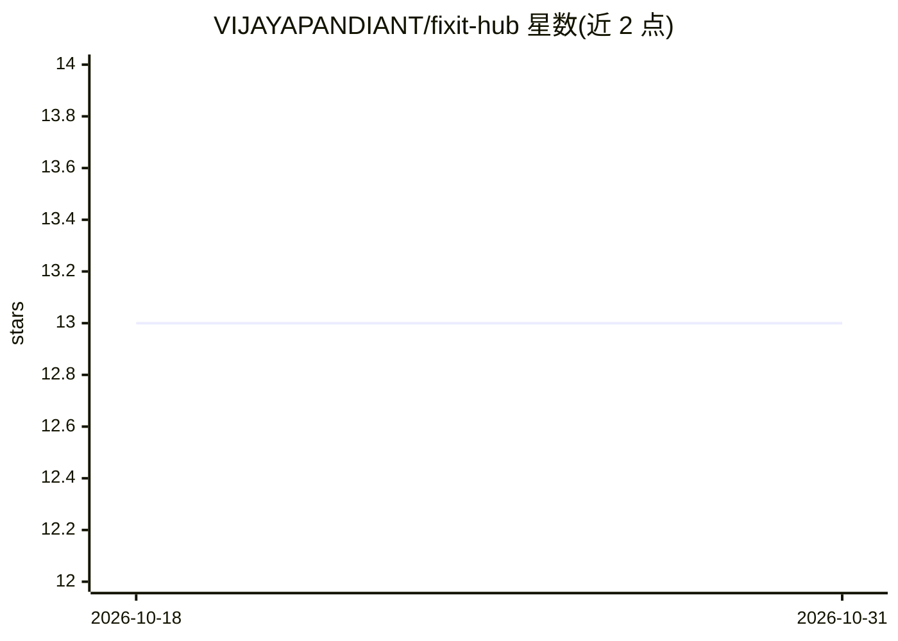

# VIJAYAPANDIANT/fixit-hub

⭐ 13 · Java · MIT · 推送 2026-08-23 · [GitHub](https://github.com/VIJAYAPANDIANT/fixit-hub) · [官网](https://fixit-hub-api.vercel.app) · 个人维护

**自托管的实时错误追踪平台，用 Gemini 生成诊断修复**

自托管、可私有部署的错误与异常监控平台：Go 摄入守护进程将原始异常写入 ClickHouse，Node.js worker 经 Redis 队列做 MD5 堆栈指纹去重，调用 Google Gemini API 生成根因分析与修复建议；Spring Boot 3 提供管理 API 与 JWT 认证，Elasticsearch 支持全文日志检索，支持 Slack/Discord webhook 告警。面向需要捕获、分诊和解决应用 Bug 的开发团队，通过 docker-compose 一键启动多容器栈。

## 筛选速览

| 维度 | 判定 | 备注 |
|---|---|---|
| AI 角色 | `ai-enhanced` | 去掉 AI 部分产品仍成立 |
| 许可风险 | `permissive` | MIT |
| 部署形态 | `self-host` | docker 或自建部署 |
| 模型依赖 | — | README 未给出锁定关系 |
| 硬件要求 | — | 无带数字的原话,不猜 |
| 安装摩擦 | `low` | 无编译、无系统依赖或容器化 |
| 成熟度 | — | 结构信号不足 |

## 能力要点

- Go 高吞吐日志摄入直写 ClickHouse，亚毫秒级记录
- MD5 堆栈指纹自动去重聚合重复崩溃
- Gemini AI 生成根因分析与可直接落地的代码修复
- React 19 仪表盘 + Elasticsearch 全文日志搜索 + Slack/Discord 告警

## 适用场景

- 团队自建错误监控与告警平台，替代外部 SaaS
- 崩溃发生时自动获得 AI 根因分析与修复建议
- 按语言、严重级别、环境、标签检索历史日志

## 场景标签

`代码审查` · 领域:编码与开发

## 证据(README 行号)

> L11: An AI-powered, self-hosted, real-time error tracking and exception monitoring system designed to help developers ca
> L23: - **🤖 LLM-Powered AI Diagnostics**: Instant Google Gemini AI integration analyzing error message contexts, trace fi

## 星数曲线

2026-10-18 13 → 2026-10-31 13（+0）

---
*卡片 v1 · prompt 1.4 · 生成 2026-10-31 · 置信度 mid · 依据 README sha `e8f7d14787c1` · [字段定义](../../DATASET.md)*
