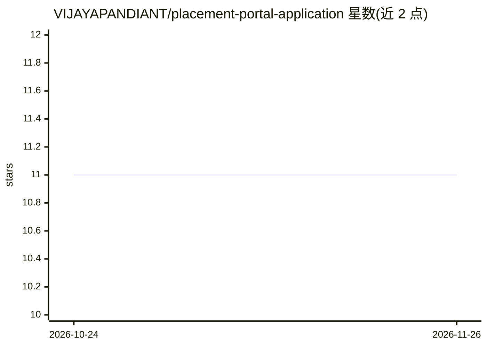

# VIJAYAPANDIANT/placement-portal-application

⭐ 11 · JavaScript · MIT · 推送 2026-08-07 · [GitHub](https://github.com/VIJAYAPANDIANT/placement-portal-application) · [官网](https://placement-portal-application-iota.vercel.app) · 个人维护

**连接学生、企业与院方管理员的校园就业全栈平台**

基于 React/Vite 前端与 Flask 后端的校园就业门户：学生注册上传 PDF 简历、企业发布招聘并筛选候选人、管理员审批企业与招聘活动并查看图表分析。集成 Groq API（llama-3.3-70b-versatile）解析简历并输出 ATS 匹配分与技能提取；通过 Celery/Redis 执行 CSV 报告等异步任务；提供 JWT 角色认证、SQLAlchemy ORM、Redis 缓存与全局深色模式。需本地 Node.js、Python 与 Redis，启动时自动写入管理员与企业演示账号。

## 筛选速览

| 维度 | 判定 | 备注 |
|---|---|---|
| AI 角色 | `ai-enhanced` | 去掉 AI 部分产品仍成立 |
| 许可风险 | `permissive` | MIT |
| 部署形态 | `library` | 以包/库形式分发 |
| 模型依赖 | locked-api |  |
| 硬件要求 | — | 无带数字的原话,不猜 |
| 安装摩擦 | `low` | 无编译、无系统依赖或容器化 |
| 成熟度 | — | 结构信号不足 |

## 能力要点

- 集成 Groq API 的 PDF 简历解析：ATS 分数、技能提取与结构反馈
- Celery/Redis 异步任务处理（CSV 报告导出、邮件）
- JWT 角色认证（30 天持久化）覆盖学生/企业/管理员三端
- 本地 SMTP 调试服务器可离线捕获邮件负载

## 适用场景

- 高校就业指导部门统一管理招聘活动与学生投递
- 企业招聘方发布岗位并筛选、面试学生候选人
- 学生上传简历获得 ATS 兼容分数与技能反馈

## 场景标签

`文档解析` · 领域:知识与检索

## 证据(README 行号)

> L11: A comprehensive, state-of-the-art full-stack application designed to streamline the campus placement process. It co
> L16: * **AI-Powered Resume Analysis**: Integrates the **Groq API (`llama-3.3-70b-versatile`)** to automatically parse st

## 星数曲线

2026-10-24 11 → 2026-11-26 11（+0）

---
*卡片 v1 · prompt 1.4 · 生成 2026-11-18 · 置信度 high · 依据 README sha `b1ba27ac3fe8` · [字段定义](../../DATASET.md)*
