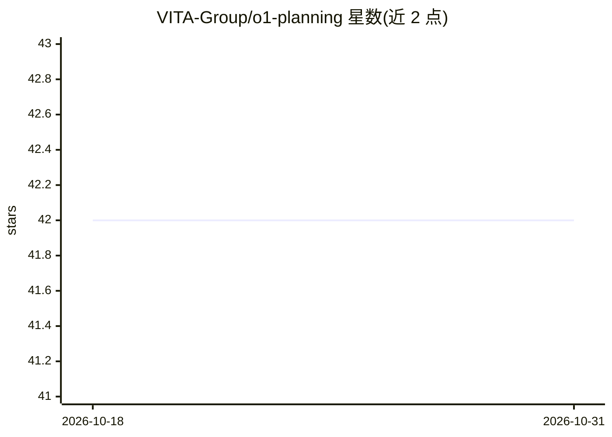

# VITA-Group/o1-planning

⭐ 42 · Python · 推送 2026-04-10 · [GitHub](https://github.com/VITA-Group/o1-planning) · [官网](https://arxiv.org/abs/2409.19924) · 组织维护

**NeurIPS'24 论文仓库：评测 o1/GPT-4 在规划任务上的表现**

NeurIPS'24 LanGame workshop 论文的官方仓库，主题为 OpenAI o1 模型的规划能力（可行性、最优性、泛化性）评测。作者在多个规划领域（如 barman 等）对 GPT-4 与 o1 进行实验，结论指出模型在问题理解上表现好、在空间推理与泛化上存在挑战。仓库存放详细实验结果文件，自动化评测脚本与数据集转移至 SPINBench 仓库提供；基础 prompt 来自 llm+p 仓库。arXiv 链接占位（coming soon）。

## 筛选速览

| 维度 | 判定 | 备注 |
|---|---|---|
| AI 角色 | `ai-knowledge` | 知识聚合/清单类 |
| 许可风险 | `none` | — |
| 部署形态 | `None` |  |
| 模型依赖 | — | README 未给出锁定关系 |
| 硬件要求 | — | 无带数字的原话,不猜 |
| 安装摩擦 | `low` | 无编译、无系统依赖或容器化 |
| 成熟度 | `idea` | |

## 能力要点

- 对 GPT-4 与 o1 在多规划领域上的实验评测结果
- 按领域组织的 results 文件目录
- 自动化评测脚本与数据集在 SPINBench 仓库发布

## 适用场景

- 查阅 o1/GPT-4 规划能力的评测细节与结果
- 基于 SPINBench 复现或扩展规划评测
- 引用该论文进行 LLM 规划能力研究

## 场景标签

`模型评测` · 领域:评测与运维

## 证据(README 行号)

> L28: We evaluated the GPT4 and o1 on planning tasks, highlighting their strength in problem understanding and identifyin
> L44: OpenAI's o1 Models
> L62: The basic prompts are from llm+p available at this GitHub repository. We thank all the authors for their great work

## 星数曲线

2026-10-18 42 → 2026-10-31 42（+0）

---
*卡片 v1 · prompt 1.4 · 生成 2026-10-25 · 置信度 high · 依据 README sha `4e9537edc17c` · [字段定义](../../DATASET.md)*
