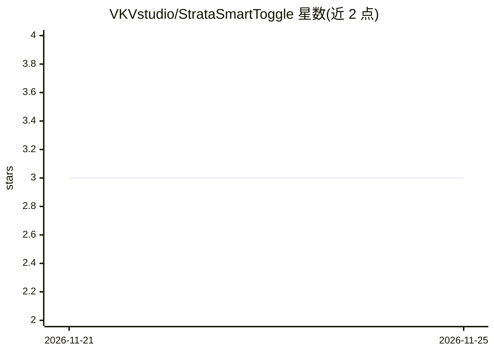

# VKVstudio/StrataSmartToggle

⭐ 3 · C# · MIT · 推送 2026-10-29 · [GitHub](https://github.com/VKVstudio/StrataSmartToggle) · 个人维护

**给 Strata 本地 LLM 引擎的任务栏启动器与 VRAM 释放工具**

面向 Windows 10/11 的 WPF 小工具，将 Niko1221/Strata 本地 MoE 推理引擎封装为任务栏图标：首次运行配置模型/量化、上下文长度（16K–128K）与数据目录，之后以紧凑模式一键启动或停止引擎；停止时执行 `strata launch --stop` 并等待 8080 端口释放以清空 GPU 显存占用。通过内置 csc.exe 编译单个 exe，无第三方依赖，可固定到任务栏独立显示。依赖 Strata 引擎本身提供推理能力。

## 筛选速览

| 维度 | 判定 | 备注 |
|---|---|---|
| AI 角色 | `ai-ecosystem` | LLM/agent 周边工具 |
| 许可风险 | `permissive` | MIT |
| 部署形态 | `desktop` | 安装包/桌面程序 |
| 模型依赖 | — | README 未给出锁定关系 |
| 硬件要求 | — | 无带数字的原话,不猜 |
| 安装摩擦 | `low` | 无编译、无系统依赖或容器化 |
| 成熟度 | — | 结构信号不足 |

## 能力要点

- 一键启动/停止 Strata 并释放 VRAM（等待 8080 端口释放、终止后台进程）
- 保存预设的紧凑模式与 16K–128K 上下文长度切换
- 零第三方依赖，用 Windows 内置 csc.exe 编译
- 注册独立 AppUserModelID，可固定到 Win11 任务栏

## 适用场景

- 在 Windows 任务栏一键启动/停止本地 Strata 推理服务
- 停止推理后立即回收 GPU 显存
- 为不同模型与上下文长度保存快捷预设

## 场景标签

 · 领域:本地 LLM 运行工具

## 证据(README 行号)

> L11: > **StrataSmartToggle** turns Strata into a true Windows 11 taskbar utility. Launch massive local MoE models, switc
> L37:  Clicking ■ STOP STRATA & FREE VRAM executes <code>strata launch --stop</code>, waits for port <code>8080</code> to

## 星数曲线

2026-11-21 3 → 2026-11-25 3（+0）

---
*卡片 v1 · prompt 1.4 · 生成 2026-11-22 · 置信度 high · 依据 README sha `d24c793202bc` · [字段定义](../../DATASET.md)*
