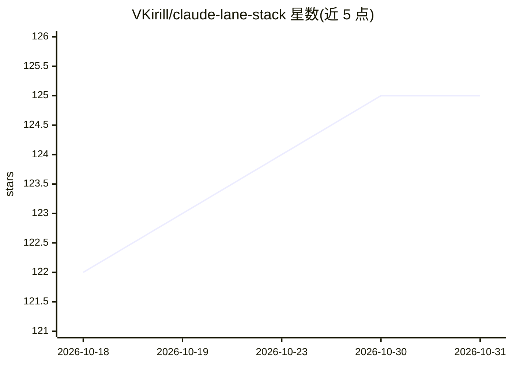

# VKirill/claude-lane-stack

⭐ 125 · Python · MIT · 推送 2026-10-29 · [GitHub](https://github.com/VKirill/claude-lane-stack) · [官网](https://github.com/VKirill/claude-lane-stack) · 个人维护

**单人使用的多 agent 编码流水线：Claude Code 任 PM 调度各厂商 CLI 写码**

自托管工具包，通过 CLI 进程、任务契约、Git worktree 工作区与验证凭据来协调多个编码 agent：Claude Code 提供项目经理界面，其他厂商的 CLI 由配置的流水线阶段选用。提供 install.sh 安装宿主工具，经 project-onboard 初始化项目后用 lane-pm 启动，含自动合并到主分支的传送带机制。README 为简版，详细文档另列。

## 筛选速览

| 维度 | 判定 | 备注 |
|---|---|---|
| AI 角色 | `ai-ecosystem` | LLM/agent 周边工具 |
| 许可风险 | `permissive` | MIT |
| 部署形态 | `None` |  |
| 模型依赖 | — | README 未给出锁定关系 |
| 硬件要求 | — | 无带数字的原话,不猜 |
| 安装摩擦 | `low` | 无编译、无系统依赖或容器化 |
| 成熟度 | — | 结构信号不足 |

## 能力要点

- 通过 CLI 进程与任务契约协调多厂商编码 agent
- Claude Code 作为项目经理界面编排其他 writer CLI
- Git worktree 工作区隔离与验证凭据（verification receipts）
- install.sh 一键安装宿主工具链

## 适用场景

- 单人开发者搭建多 agent 流水线自动写码与合并
- 在不同厂商编码 CLI 之间按阶段路由任务
- 用任务契约和验证凭据约束 agent 产出

## 场景标签

`多智能体` `编码 Agent` · 领域:Agent 开发

## 证据(README 行号)

> L3: Claude Lane Stack is a self-hosted toolkit for coordinating coding agents through CLI processes, task contracts, Git
> L11: project-onboard .

## 星数曲线

2026-10-18 122 → 2026-10-31 125（+3）

---
*卡片 v1 · prompt 1.4 · 生成 2026-10-23 · 置信度 high · 依据 README sha `2658e8c0fbe0` · [字段定义](../../DATASET.md)*
