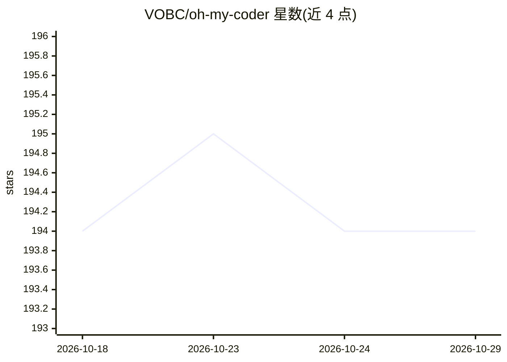

# VOBC/oh-my-coder

⭐ 194 · Python · MIT · 推送 2026-09-24 · [GitHub](https://github.com/VOBC/oh-my-coder) · [官网](https://vobc.github.io/oh-my-coder) · 组织维护 · 中文 README

**面向国内开发者的多 Agent 编程助手，支持国产大模型**

多智能体协作编程系统，内置 31 个专业 Agent 与 10 个工作流模板（build/review/debug/test 等），按构建、审查、领域、协调、安全五个通道组织。支持 DeepSeek、智谱 GLM、Kimi、豆包、百川等国产模型及 Ollama 本地模型，通过三层模型路由按任务类型与成本自动选择。提供 CLI、Web 界面与 VS Code 插件，全中文交互，任务完成后生成含 Token 消耗与成本的总结，自动沉淀 SKILL.md 技能。要求 Python 3.9+，各模型需配置 API Key（GLM-4.7-Flash 免费额度可用）。

## 筛选速览

| 维度 | 判定 | 备注 |
|---|---|---|
| AI 角色 | `ai-native` | 本体是模型或模型工具 |
| 许可风险 | `permissive` | MIT |
| 部署形态 | `self-host` | docker 或自建部署 |
| 模型依赖 | local-ok | 支持本地模型 |
| 硬件要求 | — | 无带数字的原话,不猜 |
| 安装摩擦 | `low` | 无编译、无系统依赖或容器化 |
| 成熟度 | `idea` | |

## 能力要点

- 31 个专业 Agent，按五大通道覆盖完整开发流程
- 支持 12 家国产模型 + Ollama 本地模型，三层模型路由自动选择
- 提供 CLI / Web 界面 / VS Code 插件三种使用方式
- 工作目录上下文感知、快照回滚、MCP Server 支持

## 适用场景

- 用自然语言描述任务，让多 Agent 协作完成代码生成、审查、调试与测试
- 国内网络环境下免翻墙使用国产模型的 AI 编程助手
- 通过 Ollama 本地模型离线进行私有化部署编程辅助

## 场景标签

`编码 Agent` `多智能体` `代码生成` `代码审查` · 领域:Agent 开发

## 证据(README 行号)

> L3: > 🤖 **31 个专业 Agent · 12 家国产大模型 · 自进化系统** — 国产首个多 Agent 编程框架，开箱即用。
> L137: Oh My Coder 是一个**多智能体协作编程系统**，通过多个专业 Agent 协作完成复杂开发任务。

## 星数曲线

2026-10-18 194 → 2026-10-29 194（+0）

---
*卡片 v1 · prompt 1.4 · 生成 2026-10-23 · 置信度 mid · 依据 README sha `2ef82a5b7ca3` · [字段定义](../../DATASET.md)*
