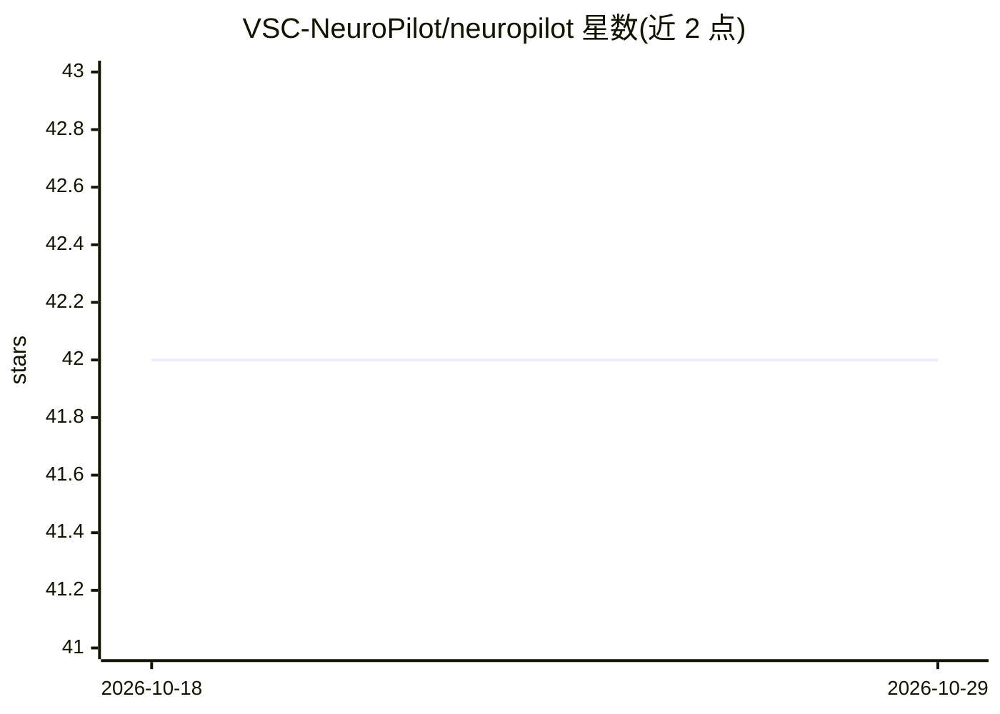

# VSC-NeuroPilot/neuropilot

⭐ 42 · TypeScript · MIT · 推送 2026-10-05 · [GitHub](https://github.com/VSC-NeuroPilot/neuropilot) · [官网](https://vsc-neuropilot.github.io/neuropilot/) · 组织维护

**通过 Neuro API 控制 VS Code 的扩展**

VS Code 扩展 NeuroPilot 的主仓库，允许通过 Neuro API 对 VS Code 进行控制。仓库采用双分支结构：master 分支包含当前发布到各市场的代码，dev 分支包含下一次发布前的所有更改，PR 需面向 dev 分支提交，构建通过 Actions 工作流从 master 分支发布。README 仅说明仓库结构与贡献流程，未详述扩展的具体功能与安装方式。

## 筛选速览

| 维度 | 判定 | 备注 |
|---|---|---|
| AI 角色 | `ai-ecosystem` | LLM/agent 周边工具 |
| 许可风险 | `permissive` | MIT |
| 部署形态 | `None` |  |
| 模型依赖 | — | README 未给出锁定关系 |
| 硬件要求 | — | 无带数字的原话,不猜 |
| 安装摩擦 | `low` | 无编译、无系统依赖或容器化 |
| 成熟度 | — | 结构信号不足 |

## 能力要点

- VS Code 扩展，经 Neuro API 实现控制
- master/dev 双分支发布流程
- 通过 GitHub Actions 从 master 分支构建发布

## 适用场景

- 在 VS Code 中接入 Neuro API 进行控制
- 通过 PR 到 dev 分支参与贡献

## 场景标签

`编码 Agent` · 领域:编码与开发

## 证据(README 行号)

> L3: This is the main GitHub repository for the NeuroPilot VS Code extension.

## 星数曲线

2026-10-18 42 → 2026-10-29 42（+0）

---
*卡片 v1 · prompt 1.4 · 生成 2026-10-25 · 置信度 low · 依据 README sha `3f62a04495fc` · [字段定义](../../DATASET.md)*
