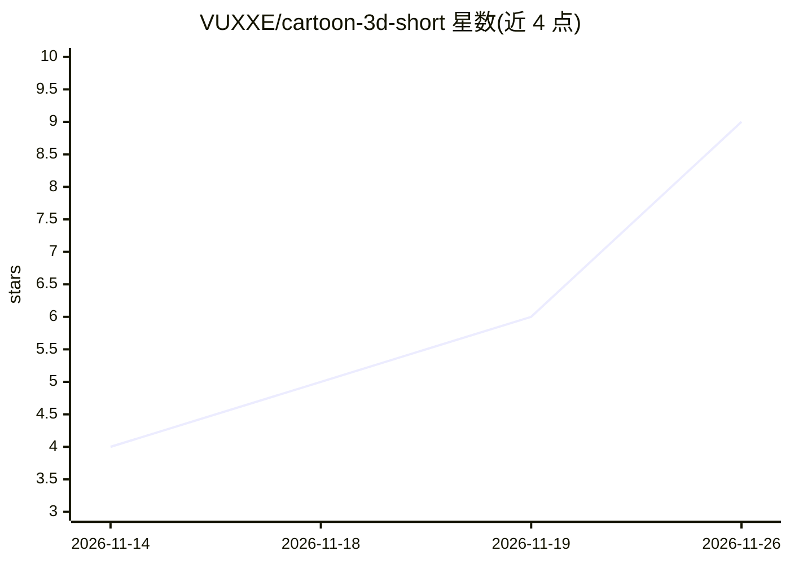

# VUXXE/cartoon-3d-short

⭐ 9 · TypeScript · MIT · 推送 2026-11-08 · [GitHub](https://github.com/VUXXE/cartoon-3d-short) · 个人维护

**让 AI agent 生成 2D 角色入 3D 世界的动画故事短片的技能包**

一个面向 Gemini、Claude Code、OpenAI Codex 等 LLM agent 的通用技能（skill），按 SKILL.md 定义的流程生成约 55–70 秒竖屏动画故事短片：Three.js 在 Remotion 内本地 GPU 渲染、Chatterbox-Turbo 零样本本地语音克隆（支持副语言表达标签与多引擎回退）、Polyfork 3D 资产库（3,086 个低多边形模型、47 个主题套件）、程序化音效与配乐、38 张参考帧等风格资料。用户只需向 agent 下达一句话指令即可触发完整流水线。仓库从 mromidev/claude-animated-shorts fork 而来，代码为 MIT 许可。

## 筛选速览

| 维度 | 判定 | 备注 |
|---|---|---|
| AI 角色 | `ai-knowledge` | 知识聚合/清单类 |
| 许可风险 | `permissive` | MIT |
| 部署形态 | `None` |  |
| 模型依赖 | — | README 未给出锁定关系 |
| 硬件要求 | — | 无带数字的原话,不猜 |
| 安装摩擦 | `low` | 无编译、无系统依赖或容器化 |
| 成熟度 | — | 结构信号不足 |

## 能力要点

- SKILL.md 定义完整生成流水线，agent 一句话指令即可产出 2K 竖屏短片
- 本地语音克隆（Chatterbox-Turbo）与 Kokoro/Piper/Edge-TTS 多引擎回退
- 离线 Polyfork 目录：3,086 个低多边形 3D 模型、47 个主题套件与资产 CLI
- 程序化音效引擎 48+ 生成器，按 -15 LUFS / -1.2 dBTP 母带处理

## 适用场景

- 让本地 AI agent 帮我制作竖屏动画故事短片
- 生成带克隆配音与音效的解说类短视频
- 基于 Polyfork 3D 资产库搭建 Three.js 动画场景

## 场景标签

`语音合成` `视频生成` · 领域:内容生成

## 证据(README 行号)

> L1: # Cartoon 3D Story Shorts (Universal AI Agent Skill)
> L3: A universal AI agent skill for **Google Gemini**, **Claude Code**, **OpenAI Codex**, and any LLM agent harness to cr
> L40: |`SKILL.md`|The skill definition: full pipeline, rules, look values, and verification loops|

## 星数曲线

2026-11-14 4 → 2026-11-26 9（+5）

---
*卡片 v1 · prompt 1.4 · 生成 2026-11-20 · 置信度 high · 依据 README sha `093b24576376` · [字段定义](../../DATASET.md)*
