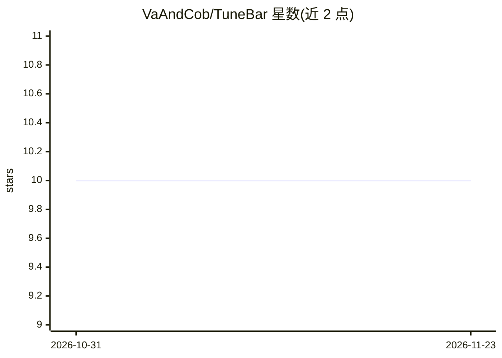

# VaAndCob/TuneBar

⭐ 10 · C · GPL-3.0 · 推送 2026-06-24 · [GitHub](https://github.com/VaAndCob/TuneBar) · 个人维护

**基于 ESP32-S3 的掌上网络收音机/音乐播放器，附天气与空气质量显示**

运行于 Waveshare ESP32-S3-Touch-LCD-3.49 硬件的自制固件项目，集成网络收音机（WiFi 流媒体）、本地音频播放（MP3/FLAC/AAC/WAV）、每 15 分钟更新的天气与空气质量显示、数字时钟、手电筒与 OTA 无线固件更新。UI 基于 LVGL 并用 SquareLine Studio 设计，电台列表通过 FAT32 SD 卡上的 station.csv 上传，仅支持 http 流 URL。提供免编译的在线刷写路径，也支持 VSCode + pioarduino 环境自行构建；许可为 CC BY-NC-SA 4.0（非商业）。

## 筛选速览

| 维度 | 判定 | 备注 |
|---|---|---|
| AI 角色 | `ai-enhanced` | 去掉 AI 部分产品仍成立 |
| 许可风险 | `viral` | GPL-3.0 |
| 部署形态 | `None` |  |
| 模型依赖 | — | README 未给出锁定关系 |
| 硬件要求 | — | 无带数字的原话,不猜 |
| 安装摩擦 | `low` | 无编译、无系统依赖或容器化 |
| 成熟度 | — | 结构信号不足 |

## 能力要点

- 通过 station.csv（SD 卡上传）自定义网络电台列表
- 支持 MP3/FLAC/AAC/WAV 本地播放，音频核心基于 ESP32-audioI2S 库
- OTA 无线固件更新与 LVGL 触摸屏 UI
- 提供免写代码的在线刷写方式

## 适用场景

- 在桌面放一台网络收音机收听流媒体电台
- 从 SD 卡播放自己的音乐文件
- 查看所在位置的实时天气与空气质量

## 场景标签

 · 领域:嵌入式硬件/媒体播放

## 证据(README 行号)

> L4: **TuneBar** is a custom-engineered, palm-sized media bar powered by the ESP32-S3. Its compact, stick-like design all
> L6: This project integrates a versatile music player and internet radio with practical daily utilities—including real-ti
> L25:  - AI Voice Chat

## 星数曲线

2026-10-31 10 → 2026-11-23 10（+0）

---
*卡片 v1 · prompt 1.4 · 生成 2026-11-20 · 置信度 high · 依据 README sha `61d87ac79e5a` · [字段定义](../../DATASET.md)*
