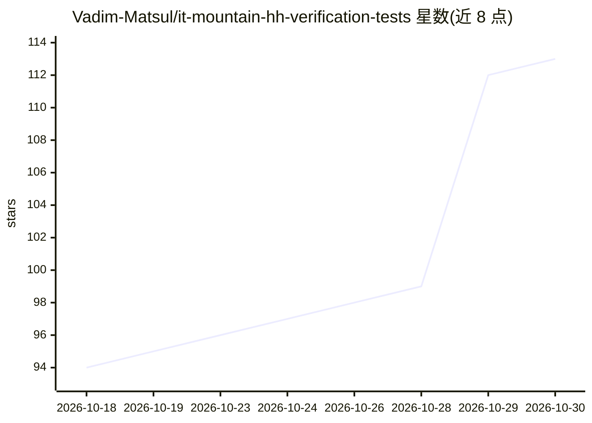

# Vadim-Matsul/it-mountain-hh-verification-tests

⭐ 113 · NOASSERTION · 推送 2026-10-29 · [GitHub](https://github.com/Vadim-Matsul/it-mountain-hh-verification-tests) · [官网](https://it-mountain.ru/hh-tests) · 个人维护

**hh.ru 技能测验答案合集：21 个主题 827 题供备考**

面向参加 hh.ru 技能测验的求职者的答案集合仓库：声称基于 61,628 条记录整理出 5,881 个唯一问题，仓库内公开 827 题，覆盖 JavaScript、CSS、Git、算法、Python、Docker、机器学习等 21 个主题（SCRUM 测验已从平台下线）。仓库声明 hh.ru 未参与也不认可本项目，材料来自社区公开讨论与参与者回忆，供自学参考；完整题库通过外部站点与 Telegram 机器人访问，其中可能含付费服务链接。

## 筛选速览

| 维度 | 判定 | 备注 |
|---|---|---|
| AI 角色 | `ai-knowledge` | 知识聚合/清单类 |
| 许可风险 | `none` | NOASSERTION |
| 部署形态 | `None` |  |
| 模型依赖 | — | README 未给出锁定关系 |
| 硬件要求 | — | 无带数字的原话,不猜 |
| 安装摩擦 | `low` | 无编译、无系统依赖或容器化 |
| 成熟度 | — | 结构信号不足 |

## 能力要点

- 21 个主题共 827 题公开在仓库中
- 声称基于 61,628 条记录整理 5,881 个唯一问题
- 提供外部完整题库站点与 Telegram 机器人入口

## 适用场景

- 查找 hh.ru 技能测验的题目答案
- 备考前按主题（Git/Docker/算法等）预览测验题型

## 场景标签

`精选清单` · 领域:学习与行业

## 证据(README 行号)

> L15:  ОТВЕТЫ на тесты по навыкам и языкам HH.RU
> L22:  проанализировано 61 628 записей
> L32: |Тема|В репозитории|В полной базе|IT Mountain|HH.ru|

## 星数曲线

2026-10-18 94 → 2026-10-30 113（+19）

---
*卡片 v1 · prompt 1.4 · 生成 2026-10-23 · 置信度 high · 依据 README sha `c9eca9f320bd` · [字段定义](../../DATASET.md)*
