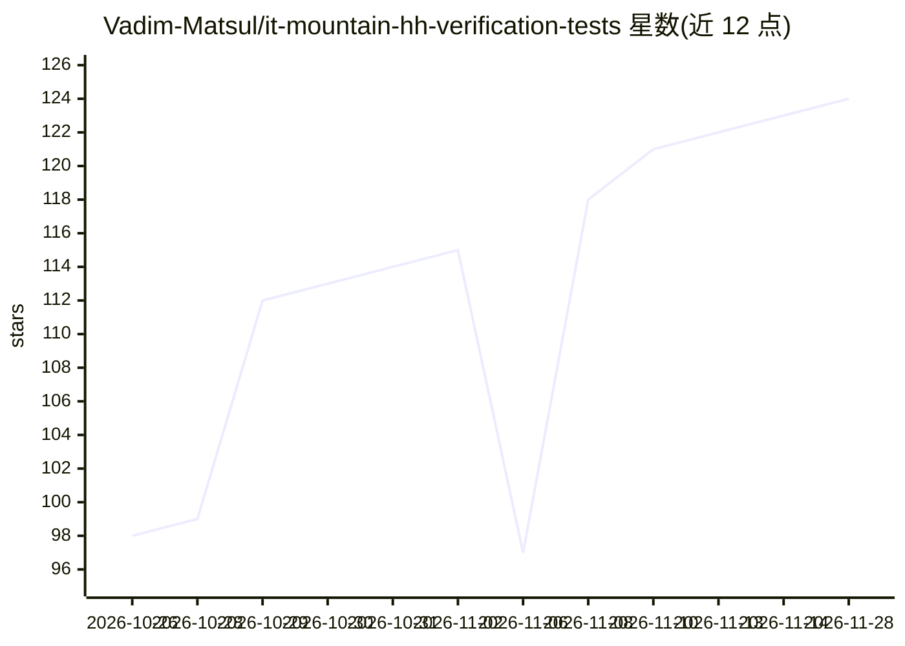

# Vadim-Matsul/it-mountain-hh-verification-tests

⭐ 124 · NOASSERTION · 推送 2026-11-27 · [GitHub](https://github.com/Vadim-Matsul/it-mountain-hh-verification-tests) · [官网](https://it-mountain.ru/hh-tests) · 个人维护

**hh.ru 技能测试答案库：助求职者一次通过**

汇总 hh.ru 平台 21 个技能确认测试的答案资料：基于 61,628 条社区记录整理出 5,881 个问题，仓库内公开 827 题，覆盖 JavaScript、CSS、HTML、Git、算法、SQL、Docker、机器学习等 21 个主题；完整答案库通过外部网站与 Telegram 渠道提供。README 明确声明 hh.ru 未参与且不认可该项目，材料来自公开讨论与考生回忆，供自查备考使用。

## 筛选速览

| 维度 | 判定 | 备注 |
|---|---|---|
| AI 角色 | `ai-knowledge` | 知识聚合/清单类 |
| 许可风险 | `none` | NOASSERTION |
| 部署形态 | `None` |  |
| 模型依赖 | — | README 未给出锁定关系 |
| 硬件要求 | — | 无带数字的原话,不猜 |
| 安装摩擦 | `low` | 无编译、无系统依赖或容器化 |
| 成熟度 | — | 结构信号不足 |

## 能力要点

- 整理 21 个 hh.ru 技能测试主题的答案表
- 基于 61,628 条记录提取 5,881 个问题，仓库公开 827 题
- 按主题提供仓库版与完整库的对照链接

## 适用场景

- 求职前准备 hh.ru 的技能确认测试
- 按主题查找测试题目对应的参考答案

## 场景标签

`精选清单` · 领域:学习与行业

## 证据(README 行号)

> L15:  ОТВЕТЫ на тесты по навыкам и языкам HH.RU
> L23:  5 881 вопросов в базе
> L25:  21 тема для списывания

## 星数曲线

2026-10-26 98 → 2026-11-28 124（+26）

---
*卡片 v1 · prompt 1.4 · 生成 2026-11-28 · 置信度 high · 依据 README sha `ea04182a2dbe` · [字段定义](../../DATASET.md)*
