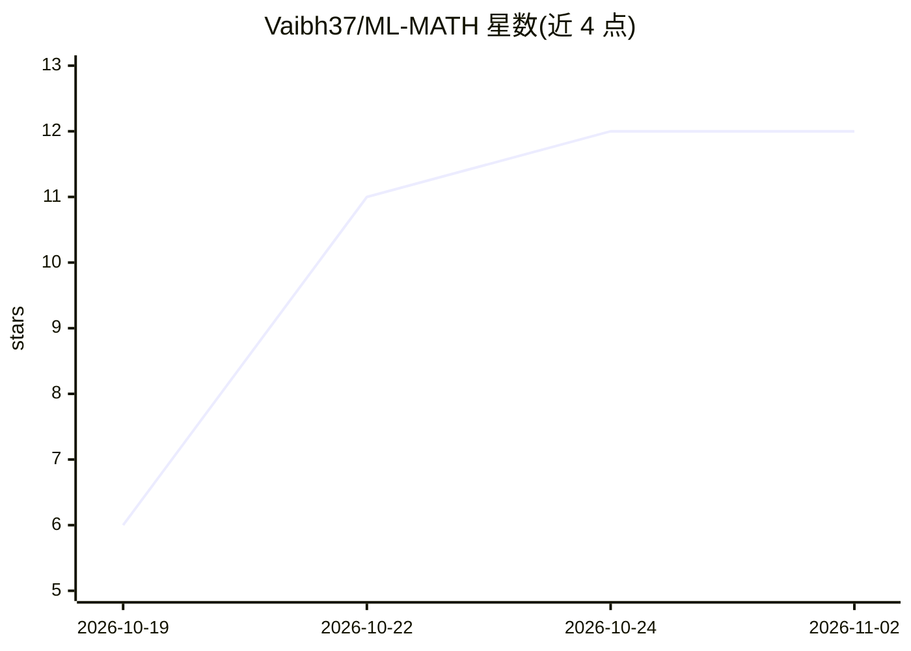

# Vaibh37/ML-MATH

⭐ 12 · Python · MIT · 推送 2026-10-18 · [GitHub](https://github.com/Vaibh37/ML-MATH) · 个人维护

**机器学习数学学习笔记仓库：线代/微积分与 NumPy 实现**

个人学习笔记形式的机器学习数学知识库，覆盖线性代数（向量、矩阵、余弦相似度）、微积分（导数、链式法则、梯度下降、XOR 反向传播推导），并附可运行的 NumPy 实现，包括完整两层 XOR 神经网络训练。内容按主题组织为学习路径，未完成的主题（数值梯度检验、概率统计等）明确标注为待学。面向需要补足 ML 数学基础的开发者与学习者，仓库以 Markdown 笔记与 Python 代码形式提供，无安装包或打包发布。

## 筛选速览

| 维度 | 判定 | 备注 |
|---|---|---|
| AI 角色 | `ai-knowledge` | 知识聚合/清单类 |
| 许可风险 | `permissive` | MIT |
| 部署形态 | `None` |  |
| 模型依赖 | — | README 未给出锁定关系 |
| 硬件要求 | — | 无带数字的原话,不猜 |
| 安装摩擦 | `low` | 无编译、无系统依赖或容器化 |
| 成熟度 | — | 结构信号不足 |

## 能力要点

- 从单样本损失推导梯度下降并做五次数值验证
- 完整两层 XOR 反向传播推导及 NumPy 实现
- 向量/矩阵/余弦相似度等线代主题的公式速查表
- 方法论标注未完成主题而非声称已完成

## 适用场景

- 通过推导加代码对照学习反向传播与梯度下降
- 查阅 NumPy 语法与线代公式速查表
- 按主题清单规划机器学习数学自学路径

## 场景标签

`教程课程` · 领域:学习与行业

## 证据(README 行号)

> L1: # Mathematics for Machine Learning
> L3: Practical mathematics notes for computer science, machine learning, deep learning, and ML engineering.
> L5: The focus is on **what each concept means in code**, **how to represent it with NumPy**, and **where it appears in M

## 星数曲线

2026-10-19 6 → 2026-11-02 12（+6）

---
*卡片 v1 · prompt 1.4 · 生成 2026-11-01 · 置信度 high · 依据 README sha `7bf9ee6264aa` · [字段定义](../../DATASET.md)*
