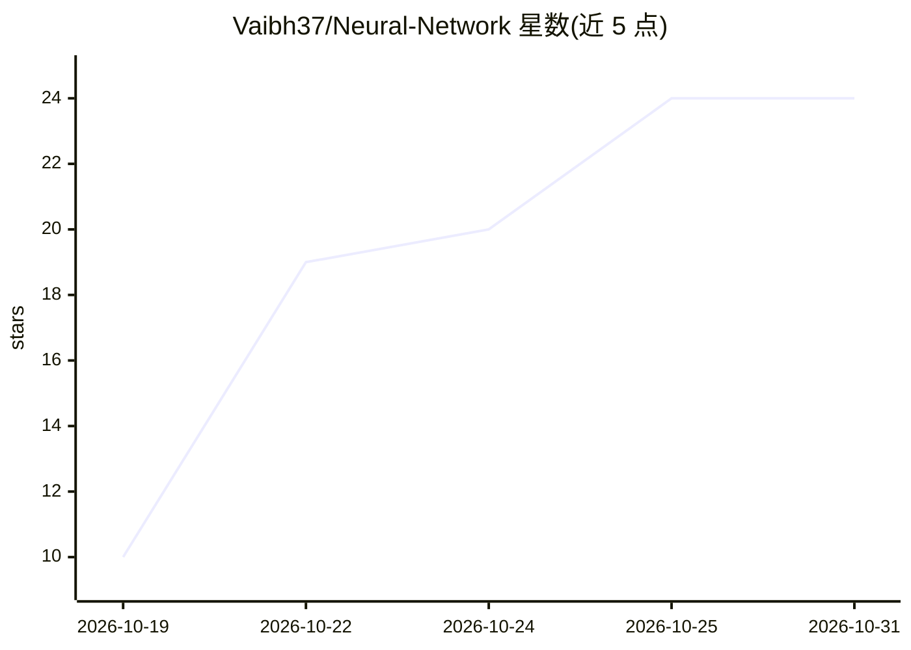

# Vaibh37/Neural-Network

⭐ 24 · Python · MIT · 推送 2026-10-21 · [GitHub](https://github.com/Vaibh37/Neural-Network) · 个人维护

**从零构建神经网络的学习笔记与代码库（NumPy 实现可训练 XOR 网络）**

个人学习型仓库：以 16 课笔记从单个神经元、损失函数、链式法则、反向传播逐步推进，最终用纯 NumPy（无 PyTorch/TensorFlow）实现 2→3→1 结构、13 个可训练参数的 XOR 网络，随机种子 42、学习率 0.05、5,000 轮训练后 4/4 预测正确（最终 MSE 0.004715）。配套 9 个可单独运行的示例脚本、有限差分梯度校验脚本与 GitHub Actions 自动检查。限制：仅验证训练集上的确定性运行，不测量未见数据的表现。

## 筛选速览

| 维度 | 判定 | 备注 |
|---|---|---|
| AI 角色 | `ai-knowledge` | 知识聚合/清单类 |
| 许可风险 | `permissive` | MIT |
| 部署形态 | `library` | 以包/库形式分发 |
| 模型依赖 | — | README 未给出锁定关系 |
| 硬件要求 | — | 无带数字的原话,不猜 |
| 安装摩擦 | `low` | 无编译、无系统依赖或容器化 |
| 成熟度 | — | 结构信号不足 |

## 能力要点

- 纯 NumPy 实现的完整 XOR 训练（前向、MSE、隐层梯度、批量梯度下降）
- 13 个参数的解析梯度与中心有限差分数值校验
- 16 课渐进式笔记 + 9 个可独立运行的示例脚本
- 12 张 SVG/PNG/Excalidraw 图解（结构、链式法则、梯度路径）

## 适用场景

- 从第一性原理学习反向传播与梯度下降的数学
- 逐步运行并核对每个教学示例
- 查阅导数与 NumPy 矩阵形状速查表

## 场景标签

`教程课程` · 领域:学习与行业

## 证据(README 行号)

> L3: This repo is where I keep my work on neural networks, from the first neuron to a trainable XOR network.
> L101: There are 16 lessons. The first 10 build up the maths and smaller examples. The last 6 cover the actual XOR networ

## 星数曲线

2026-10-19 10 → 2026-10-31 24（+14）

---
*卡片 v1 · prompt 1.4 · 生成 2026-10-27 · 置信度 mid · 依据 README sha `774335cb25ba` · [字段定义](../../DATASET.md)*
