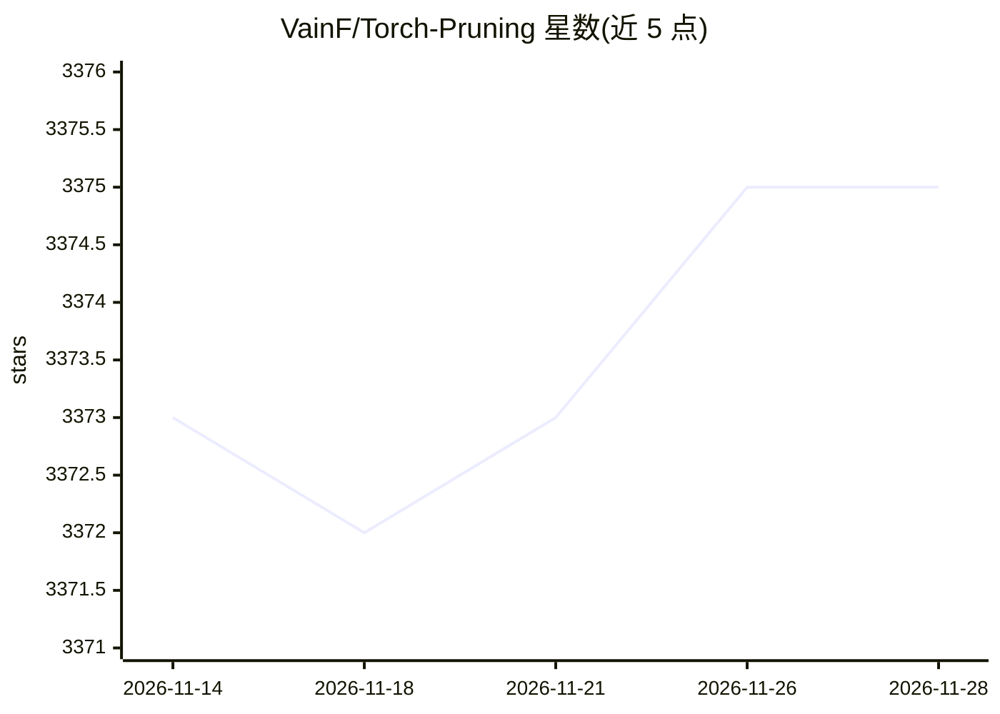

# VainF/Torch-Pruning

⭐ 3,375 · Python · MIT · 推送 2026-11-13 · [GitHub](https://github.com/VainF/Torch-Pruning) · [官网](https://arxiv.org/abs/2301.12900) · 组织维护 · 中文 README

**通用结构化剪枝框架：自动识别层依赖并移除耦合参数**

基于 CVPR'23 论文 DepGraph 的 PyTorch 结构化剪枝库：通过图算法 DepGraph 自动分析层间依赖、收集耦合参数组，实现物理移除参数而非仅掩码置零，区别于 torch.nn.utils.prune。提供高层剪枝器（支持全局剪枝、Isomorphic Pruning、稀疏训练、交互式剪枝）与底层单层剪枝函数，可剪枝 HuggingFace/Timm/Torchvision 的现成模型，含 LLM（Llama、Qwen、DeepSeek-R1-Distill）、SAM、Diffusion、ViT 等。仅依赖 PyTorch 与 Numpy，需在启用 AutoGrad 时构建依赖图；剪枝后模型需整体保存而非 state_dict。

## 筛选速览

| 维度 | 判定 | 备注 |
|---|---|---|
| AI 角色 | `ai-ecosystem` | LLM/agent 周边工具 |
| 许可风险 | `permissive` | MIT |
| 部署形态 | `library` | 以包/库形式分发 |
| 模型依赖 | — | README 未给出锁定关系 |
| 硬件要求 | — | 无带数字的原话,不猜 |
| 安装摩擦 | `low` | 无编译、无系统依赖或容器化 |
| 成熟度 | — | 结构信号不足 |

## 能力要点

- DepGraph 图算法自动识别跨层依赖并分组剪枝
- 高层剪枝器支持全局剪枝/Isomorphic Pruning/稀疏训练/交互式剪枝
- 提供单层低层剪枝函数与自定义层扩展机制
- 示例覆盖 LLM、SAM、Diffusion、ViT、ConvNext、YOLO 等模型

## 适用场景

- 压缩预训练模型以减少参数量与推理开销
- 对 LLM、ViT 等耦合结构网络做结构化剪枝实验
- 复现或对比 DepGraph 论文中的剪枝结果

## 场景标签

`模型量化` · 领域:训练与推理

## 证据(README 行号)

> L13: Torch-Pruning (TP) is a framework for structural pruning with the following features:
> L15: * **General-purpose Pruning Toolkit:** TP enables structural pruning for a wide range of deep neural networks. Diff
> L18: For more technical details, please refer to our CVPR'23 paper.

## 星数曲线

2026-11-14 3,373 → 2026-11-28 3,375（+2）

---
*卡片 v1 · prompt 1.4 · 生成 2026-11-17 · 置信度 high · 依据 README sha `c154b8b3e903` · [字段定义](../../DATASET.md)*
