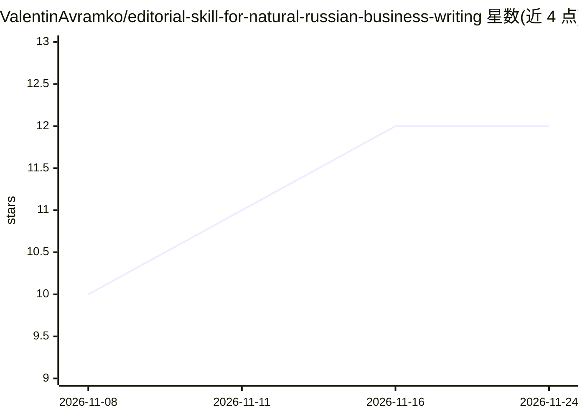

# ValentinAvramko/editorial-skill-for-natural-russian-business-writing

⭐ 12 · Python · MIT · 推送 2026-07-10 · [GitHub](https://github.com/ValentinAvramko/editorial-skill-for-natural-russian-business-writing) · [官网](https://github.com/ValentinAvramko/editorial-skill-for-natural-russian-business-writing#readme) · 个人维护

**面向俄语商务写作者的 AI 编辑工具，去除 AI 腔与套话**

一套用于俄语商务文本编辑的 prompt 工程规范集合，目标是重写带有 AI 腔、公文体、职场套话的文本，同时保持事实与商务语气不变。核心编辑逻辑位于 core/，通过两个适配器分发：可复制到 Codex 与 Claude Code skills 目录的 skill 包，以及可在 ChatGPT/Gemini 对话中粘贴的 prompt 文件。包含模式与示例参考、评估用例和一个轻量 eval-runner。README 明确说明它不适用于创意写作，也不保证能规避 AI 检测器。

## 筛选速览

| 维度 | 判定 | 备注 |
|---|---|---|
| AI 角色 | `ai-native` | 本体是模型或模型工具 |
| 许可风险 | `permissive` | MIT |
| 部署形态 | `None` |  |
| 模型依赖 | — | README 未给出锁定关系 |
| 硬件要求 | — | 无带数字的原话,不猜 |
| 安装摩擦 | `low` | 无编译、无系统依赖或容器化 |
| 成熟度 | — | 结构信号不足 |

## 能力要点

- 平台中立 core/ 与 skill、prompt 两类适配器
- skill 包可安装到 Codex 与 Claude Code（含 Windows/macOS/Linux 复制命令）
- 轻量 eval-runner 与评估用例支持可复现的运行
- 参考模式与示例词典用于识别 AI 腔特征

## 适用场景

- 重写求职信和简历回复，去除 AI 生成痕迹
- 在不破坏事实的前提下编辑商务邮件和工作消息
- 通过可复现的编辑标准批量处理俄语商务文本
- 为团队 AI 写作流程构建 prompt 设计系统

## 场景标签

`提示工程` `AI 写作` · 领域:Agent 开发

## 证据(README 行号)

> L3: Этот репозиторий содержит редакторский инструмент и набор спецификаций для prompt-инженерии, который помогает перепи
> L54: - единый portable skill для Codex и Claude Code;
> L170: 1. установка общего `skill` в Codex;

## 星数曲线

2026-11-08 10 → 2026-11-24 12（+2）

---
*卡片 v1 · prompt 1.4 · 生成 2026-11-18 · 置信度 high · 依据 README sha `f4190fb91aff` · [字段定义](../../DATASET.md)*
