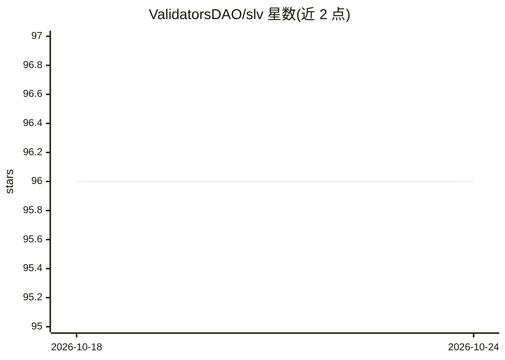

# ValidatorsDAO/slv

⭐ 96 · TypeScript · Apache-2.0 · 推送 2026-10-20 · [GitHub](https://github.com/ValidatorsDAO/slv) · [官网](https://slv.dev) · 组织维护

**给 Solana 节点运营者的开源运维工具包，含可选 AI 控制台**

面向 Solana 验证者与 RPC 节点运营者的开源工具包（Apache 2.0），将节点配置、源码构建、快照获取、服务管理与端点检查统一到 CLI、Ansible playbook 与 Jinja 模板中；支持 Agave、Jito、Firedancer 等客户端与 Yellowstone gRPC。可选的 AI Console 提供五个专家 agent 辅助运维，需 ERPC 浏览器 OAuth 登录，敏感 AI 工具命令需终端确认；旧版个人 Claude/OpenAI key 已停止支持。发布走带 SHA-256 校验的 bootstrap 安装器，仅支持 Linux/macOS x64/ARM64。

## 筛选速览

| 维度 | 判定 | 备注 |
|---|---|---|
| AI 角色 | `ai-enhanced` | 去掉 AI 部分产品仍成立 |
| 许可风险 | `permissive` | Apache-2.0 |
| 部署形态 | `None` |  |
| 模型依赖 | — | README 未给出锁定关系 |
| 硬件要求 | — | 无带数字的原话,不猜 |
| 安装摩擦 | `low` | 无编译、无系统依赖或容器化 |
| 成熟度 | — | 结构信号不足 |

## 能力要点

- CLI/Ansible playbook 管理 Solana 验证者、RPC 节点与 Yellowstone gRPC 部署
- AI Console 含五个专家 agent（验证者运维、RPC、基准测试、硬件采购、应用开发）
- 发布安装与升级走不可变发布校验（来源身份、provenance、载荷哈希）
- 密钥可存 1Password 并以 op:// 引用方式读取，部署默认使用 unstaked identity

## 适用场景

- 搭建并运维 Solana 主网/测试网验证者或 RPC 节点
- 通过对话让专家 agent 解释运维流程并准备命令
- 检查节点的 Alpenglow 协议升级就绪状态

## 场景标签

 · 领域:区块链/节点运维工具

## 证据(README 行号)

> L22: endpoint checks into one open-source toolkit. Use the CLI directly, add the AI
> L24: Jinja templates. AI is optional.

## 星数曲线

2026-10-18 96 → 2026-10-24 96（+0）

---
*卡片 v1 · prompt 1.4 · 生成 2026-10-23 · 置信度 high · 依据 README sha `4b818751b6e7` · [字段定义](../../DATASET.md)*
