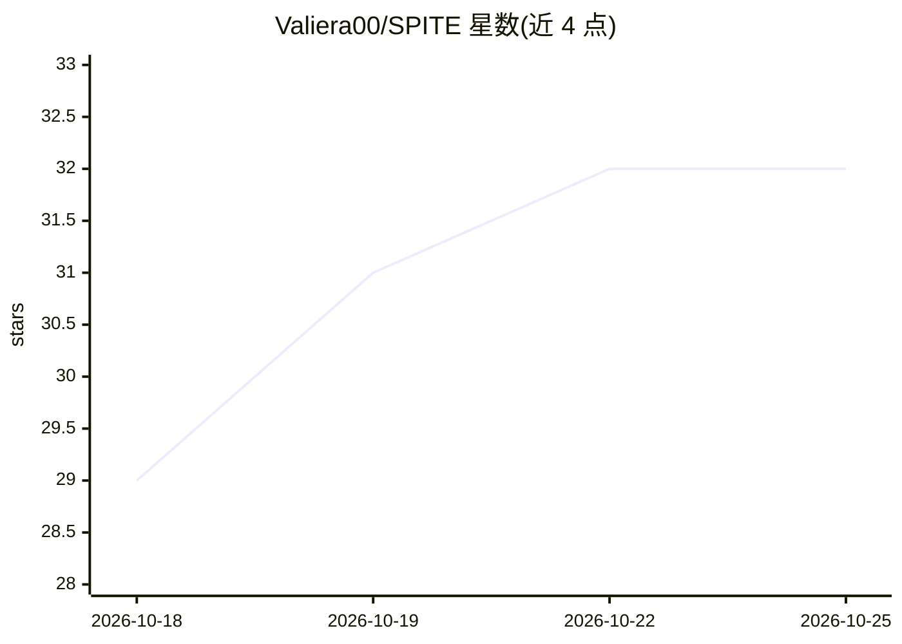

# Valiera00/SPITE

⭐ 33 · TypeScript · AGPL-3.0 · 推送 2026-10-18 · [GitHub](https://github.com/Valiera00/SPITE) · [官网](https://spite.run/) · 个人维护

**面向影视前期的 AI 生成工作台：节点画布与线性 Flow 双模式**

开源的 AI 影视前期制作工具，提供节点式无限画布（提示词、参考图、图像/视频生成节点连线编排）和线性对话式 Flow 模式（桌面与手机可用）。多模型经 fal.ai 统一路由，用户自带 API key、按次直接向提供商付费；支持角色一致性 @引用、场景/镜头结构、生成恢复（fal 24h 窗口内取回任务）、逐次生成成本提示与余额徽标、分镜 zip 导出。自托管需 Node 20+、PostgreSQL、S3 兼容存储与 fal.ai key，可部署到 Vercel 或任意 Node 环境。明确不做视频剪辑与多人协作，单用户密码门设计。

## 筛选速览

| 维度 | 判定 | 备注 |
|---|---|---|
| AI 角色 | `ai-native` | 本体是模型或模型工具 |
| 许可风险 | `viral` | AGPL-3.0 |
| 部署形态 | `library` | 以包/库形式分发 |
| 模型依赖 | — | README 未给出锁定关系 |
| 硬件要求 | — | 无带数字的原话,不猜 |
| 安装摩擦 | `low` | 无编译、无系统依赖或容器化 |
| 成熟度 | — | 结构信号不足 |

## 能力要点

- 节点画布 + 线性 Flow 双模式，多模型逐节点切换（fal.ai 路由）
- Character/Prop/Location 文件夹 @引用实现角色一致性参考注入
- 生成中断恢复：从 fal.ai 24h 保留窗口拉回已完成任务
- 每次生成显示预估成本、实时余额徽标与 $25 确认阈值

## 适用场景

- 影视前期在无限画布上编排提示词、参考与生成结果
- 用手机以对话式 Flow 快速出图/出片并复用参数
- 按场景/镜头组织素材并导出分镜 zip 到剪辑软件

## 场景标签

`图像生成` `视频生成` `提示工程` · 领域:Agent 开发

## 证据(README 行号)

> L5: An open-source studio for AI filmmaking — a node-based visual **Canvas**, plus
> L24: - **Node canvas.** Drag prompts, references, image generators, and video
> L37:  switchable per node, all routed through fal.ai with your own key.

## 星数曲线

2026-10-18 29 → 2026-10-25 32（+3）

---
*卡片 v1 · prompt 1.4 · 生成 2026-10-25 · 置信度 mid · 依据 README sha `e06285f9b1b4` · [字段定义](../../DATASET.md)*
