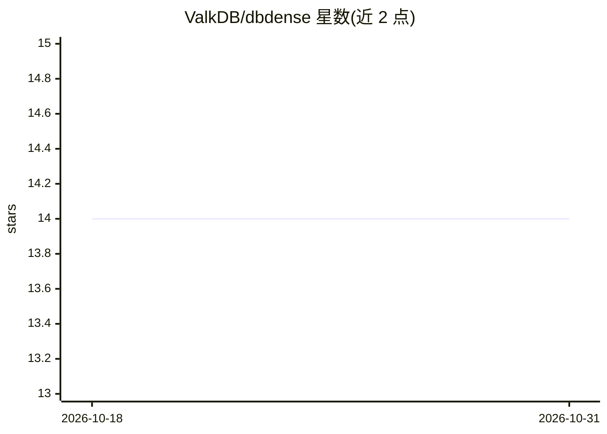

# ValkDB/dbdense

⭐ 14 · Go · Apache-2.0 · 推送 2026-03-16 · [GitHub](https://github.com/ValkDB/dbdense) · [官网](https://github.com/ValkDB/dbdense) · 组织维护

**离线抽取数据库模式并以 MCP 服务给 LLM agent 的工具**

面向开发者与 AI 编码助手的 Go 命令行工具：一次性导出 PostgreSQL/MongoDB 模式元数据为 ctxexport.json 快照，再编译成约 4K token 的 lighthouse 概览图与按需切片的 DDL 文本，可经 MCP（lighthouse 资源与 slice 工具）供 agent 使用。运行时路径完全离线、无需数据库凭据；快照为静态，模式变更需重新导出；MongoDB 无 JSON Schema 校验器时靠采样推断字段。

## 筛选速览

| 维度 | 判定 | 备注 |
|---|---|---|
| AI 角色 | `ai-ecosystem` | LLM/agent 周边工具 |
| 许可风险 | `permissive` | Apache-2.0 |
| 部署形态 | `self-host` | docker 或自建部署 |
| 模型依赖 | — | README 未给出锁定关系 |
| 硬件要求 | — | 无带数字的原话,不猜 |
| 安装摩擦 | `low` | 无编译、无系统依赖或容器化 |
| 成熟度 | — | 结构信号不足 |

## 能力要点

- export→compile→serve 三步流水线，运行时离线且无需数据库凭据
- 两级上下文模型：常驻 lighthouse 概览图 + 按需 slice DDL 切片
- sidecar YAML 可叠加人工字段描述与取值注释
- 支持 PostgreSQL 与 MongoDB 后端，可经 Extractor 接口扩展

## 适用场景

- 给 AI 编码助手提供全库模式认知而不暴露数据库连接
- 离线或隔离环境中为 LLM agent 提供模式上下文
- 用模式快照做命名规范检查、环境间漂移对比或 CI 校验

## 场景标签

 · 领域:数据库/LLM 基础设施

## 证据(README 行号)

> L94: 3. `serve` optionally exposes the snapshot over MCP:
> L99: After `export`, the runtime path is local-only. `compile`, `serve`, and Claude/MCP usage do not need database crede
> L203: - **Schema context for LLM agents** — the primary use case. Give AI coding assistants full schema awareness withou

## 星数曲线

2026-10-18 14 → 2026-10-31 14（+0）

---
*卡片 v1 · prompt 1.4 · 生成 2026-10-31 · 置信度 mid · 依据 README sha `bc35fb948553` · [字段定义](../../DATASET.md)*
