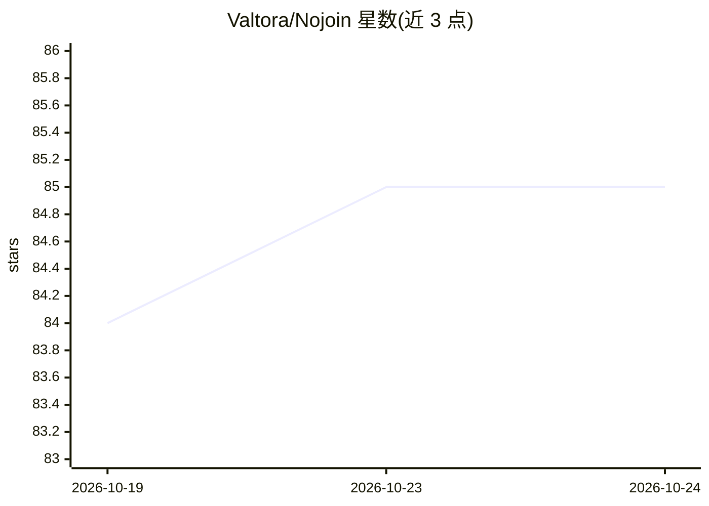

# Valtora/Nojoin

⭐ 85 · Python · AGPL-3.0 · 推送 2026-10-23 · [GitHub](https://github.com/Valtora/Nojoin) · [官网](https://www.nojoin.co.uk) · 个人维护

**自托管会议记录工具：浏览器录音、本地转写、AI 客户端经 MCP 读写笔记库**

部署在用户自己服务器上的开源会议记录系统：通过浏览器录制 Meet、Teams 和 Zoom 通话（无需机器人入会），在本机硬件上完成转写，支持跨会议声纹识别说话人。内置 MCP 服务器，Claude、ChatGPT 等客户端可对全部会议库执行 32 种工具操作（19 种写入）。笔记生成可走 API、现有 Claude/ChatGPT 订阅或本机 Ollama。另有会议实时辅助（Meeting Edge）、音频分析与日历同步。需 Docker Compose 部署，NVIDIA GPU 为推荐配置，提供付费托管服务（£24.99/人/月）。内置匿名遥测，可在设置或环境变量中关闭。

## 筛选速览

| 维度 | 判定 | 备注 |
|---|---|---|
| AI 角色 | `ai-native` | 本体是模型或模型工具 |
| 许可风险 | `viral` | AGPL-3.0 |
| 部署形态 | `self-host` | docker 或自建部署 |
| 模型依赖 | local-ok | 支持本地模型 |
| 硬件要求 | — | 无带数字的原话,不猜 |
| 安装摩擦 | `low` | 无编译、无系统依赖或容器化 |
| 成熟度 | — | 结构信号不足 |

## 能力要点

- 浏览器录制 Meet/Teams/Zoom，无机器人入会，音频留在本机
- 内置 MCP 服务器：32 个工具供 Claude/ChatGPT 等客户端读写会议库
- 转写与笔记生成可选 API、订阅或本机 Ollama 完全本地处理
- 跨会议声纹识别说话人，可修正并重建说话人库

## 适用场景

- 在自有服务器上录制并转写线上会议生成笔记
- 让 Claude/ChatGPT 检索、修正会议记录并整理行动项
- 会议通话数据不出本机硬件的本地化处理

## 场景标签

`语音识别` `知识库管理` · 领域:知识与检索

## 证据(README 行号)

> L8: Nojoin records your Meet, Teams and Zoom calls from the browser and transcribes them on your own hardware, so no bot
> L14: - **Notes from the model you choose:** an API provider, your existing Claude or ChatGPT subscription, or Ollama on 
> L21: You need Docker with Compose. An NVIDIA GPU is strongly recommended (GTX 16 or RTX 20 series or newer, driver 580 o

## 星数曲线

2026-10-19 84 → 2026-10-24 85（+1）

---
*卡片 v1 · prompt 1.4 · 生成 2026-10-24 · 置信度 high · 依据 README sha `bfec9bbd1fbe` · [字段定义](../../DATASET.md)*
