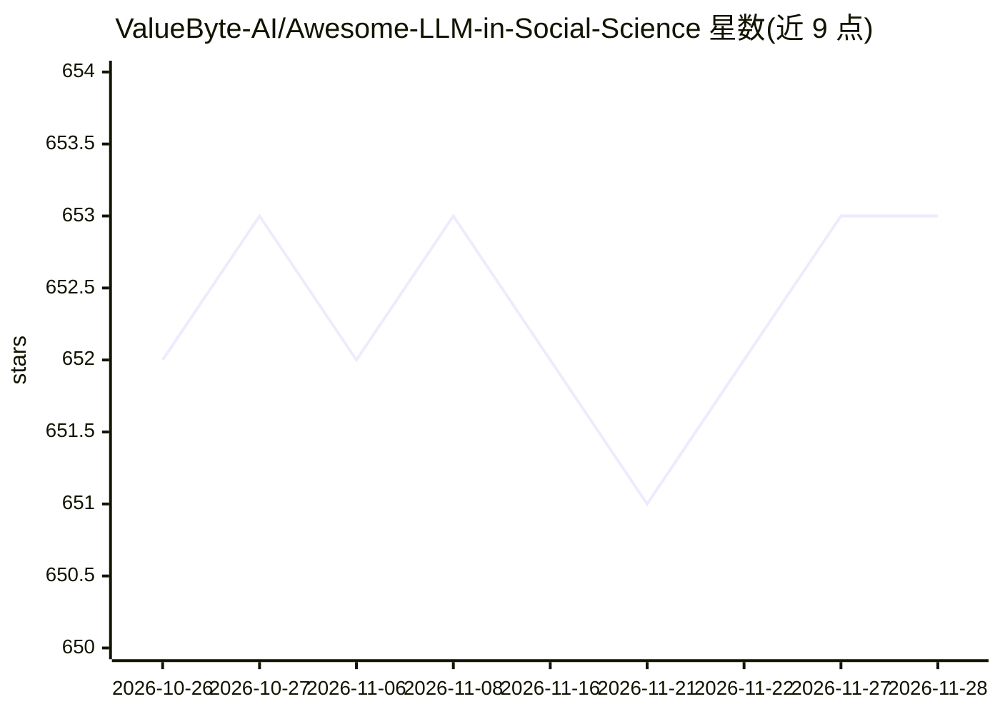

# ValueByte-AI/Awesome-LLM-in-Social-Science

⭐ 653 · MIT · 推送 2026-11-14 · [GitHub](https://github.com/ValueByte-AI/Awesome-LLM-in-Social-Science) · 组织维护 · 中文 README

**为社科研究者整理 LLM 相关社科论文的清单**

以分类清单形式收录与社会科学交叉的大语言模型论文，按综述、数据集、LLM 评估（含价值观、对齐等子类）等维度组织，收录评估、对齐、以 LLM 辅助社科研究及综述/数据集类文献，并附论文链接与部分代码/数据集链接。维护者以 ⭐️ 标注自行贡献的条目，附引用 BibTeX。仓库自述重点关注心理学与内在价值方向，接受社区贡献，不包含可运行的软件本体。

## 筛选速览

| 维度 | 判定 | 备注 |
|---|---|---|
| AI 角色 | `ai-knowledge` | 知识聚合/清单类 |
| 许可风险 | `permissive` | MIT |
| 部署形态 | `None` |  |
| 模型依赖 | — | README 未给出锁定关系 |
| 硬件要求 | — | 无带数字的原话,不猜 |
| 安装摩擦 | `low` | 无编译、无系统依赖或容器化 |
| 成熟度 | — | 结构信号不足 |

## 能力要点

- 按综述/数据集/评估/对齐等分类组织论文条目
- 条目附论文、代码、数据集与网站链接
- 维护者贡献条目以 ⭐️ 标注并提供 BibTeX 引用
- 自述侧重心理学与内在价值方向

## 适用场景

- 查找 LLM 价值观与心理测量方向的评估论文
- 为社科研究寻找可用的 LLM 数据集与基准
- 调研 LLM 社会模拟与对齐方向的文献脉络

## 场景标签

`科研工具` `精选清单` · 领域:学习与行业

## 证据(README 行号)

> L7: Below we compile *awesome* papers that
> L11: - contribute **surveys**, **perspectives**, and **datasets** on the above topics.
> L13: The above taxonomies are by no means orthogonal. For example, evaluations require simulations. We categorize these 

## 星数曲线

2026-10-26 652 → 2026-11-28 653（+1）

---
*卡片 v1 · prompt 1.4 · 生成 2026-11-24 · 置信度 high · 依据 README sha `0f147050a232` · [字段定义](../../DATASET.md)*
