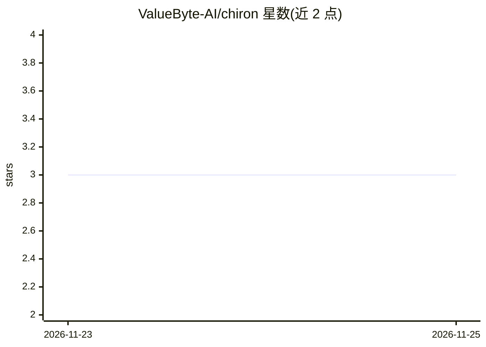

# ValueByte-AI/chiron

⭐ 3 · Python · 推送 2026-11-19 · [GitHub](https://github.com/ValueByte-AI/chiron) · 组织维护 · 中文 README

**测量并预测人类行为的心理学基础模型**

Chiron 是一个联合训练的基础模型：基于共享语言模型表示个人记录，测量 109 个预定义心理构念得分、预测个体对新问题的回答选择、并按受访层面采样生成总体响应分布。推理环境要求 Linux x86-64、Python 3.12、uv 0.11+，基于 35B 基座模型（Qwen/Qwen3.6-35B-A3B）加载 LoRA 适配器与测量头；预测与总体模拟需启动 vLLM 服务。训练使用 CUDA 12.8 工具链与内置的定制 LLaMA-Factory 后端，构建 FlashAttention 需 CUDA 开发套件与 C++ 编译器；完整训练数据包含需自行获取的受限来源。

## 筛选速览

| 维度 | 判定 | 备注 |
|---|---|---|
| AI 角色 | `ai-native` | 本体是模型或模型工具 |
| 许可风险 | `none` | — |
| 部署形态 | `None` |  |
| 模型依赖 | local-ok | 支持本地模型 |
| 硬件要求 | — | 无带数字的原话,不猜 |
| 安装摩擦 | `medium` | 含编译或系统依赖之一 |
| 成熟度 | `idea` | |

## 能力要点

- 三项任务：心理测量（109 构念）、行为预测、总体模拟
- 基于 Qwen3.6-35B-A3B 基座加载 LoRA 适配器与测量头
- 提供 vLLM 服务端与 Transformers/PyTorch 两种推理路径
- 定制训练后端随仓库分发（Apache-2.0）

## 适用场景

- 从个人日常记录中读取心理构念得分
- 预测受访者对问卷问题的回答选项
- 复现论文中的总体模拟实验（如 OBHDP_10_1b）

## 场景标签

`科研工具` · 领域:学习与行业

## 证据(README 行号)

> L23: Chiron jointly learns to measure psychological attributes, predict individual behaviour and reproduce population re
> L27: |Psychological measurement|A person's records|Scores for 109 predefined constructs|
> L28: |Behavioural prediction|Personal records and a new question|Predicted responses or choices|

## 星数曲线

2026-11-23 3 → 2026-11-25 3（+0）

---
*卡片 v1 · prompt 1.4 · 生成 2026-11-23 · 置信度 high · 依据 README sha `faaf937e282a` · [字段定义](../../DATASET.md)*
