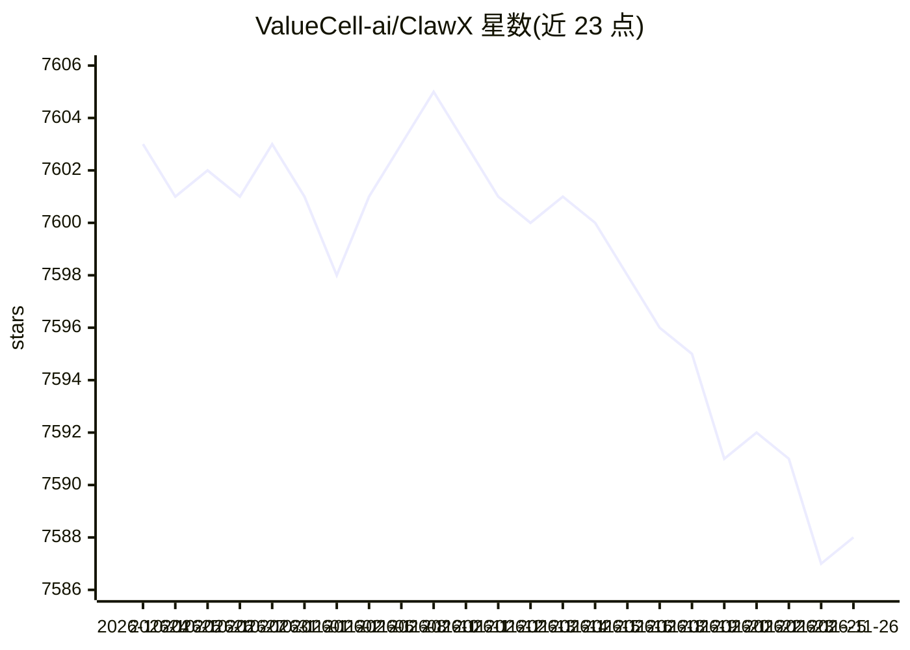

# ValueCell-ai/ClawX

⭐ 7,588 · TypeScript · MIT · 推送 2026-11-25 · [GitHub](https://github.com/ValueCell-ai/ClawX) · [官网](https://claw-x.com) · 组织维护 · 中文 README

**为 OpenClaw AI agent 提供图形界面的桌面应用**

基于 Electron/React 构建，内嵌 OpenClaw 运行时，将命令行方式的 agent 编排转为桌面体验：提供多会话聊天界面、Agent 生命周期管理、多渠道管理（内置微信插件与钉钉连接器）、Cron 定时任务、本地化技能管理、供应商统一配置面板（凭据存入系统钥匙串）。功能上还含语音听写（需开启 Developer Mode 并自配语音转文字服务）与本地 Computer Use（限 macOS 13+/Windows x64）。提供 Windows/macOS/Linux 预编译包与源码构建，另声明可联系获取企业版。

## 筛选速览

| 维度 | 判定 | 备注 |
|---|---|---|
| AI 角色 | `ai-ecosystem` | LLM/agent 周边工具 |
| 许可风险 | `permissive` | MIT |
| 部署形态 | `desktop` | 安装包/桌面程序 |
| 模型依赖 | — | README 未给出锁定关系 |
| 硬件要求 | — | 无带数字的原话,不猜 |
| 安装摩擦 | `low` | 无编译、无系统依赖或容器化 |
| 成熟度 | — | 结构信号不足 |

## 能力要点

- 内嵌 OpenClaw 运行时，免终端一键安装与引导式设置向导
- 多渠道管理：微信插件、钉钉连接器及多账号渠道配置
- Cron 定时任务与可本地管理的技能系统（含 pdf/xlsx/docx/pptx 处理技能）
- 本地 Computer Use 驱动（macOS 13+/Windows x64）与语音听写

## 适用场景

- 在桌面界面中配置和管理多个专用 AI agent
- 定时让 agent 监控信息源并把结果推送到聊天渠道
- 为非技术用户提供免命令行的 agent 使用入口
- 把 agent 接入微信/钉钉等渠道收发消息

## 场景标签

`AI 助手` `GUI 自动化` · 领域:效率与自动化

## 证据(README 行号)

> L5:  The Desktop Interface for OpenClaw AI Agents
> L26: **ClawX** bridges the gap between powerful AI agents and everyday users. Built on top of OpenClaw, it transforms co
> L47: Building AI agents shouldn't require mastering the command line. ClawX was designed with a simple philosophy: **pow

## 星数曲线

2026-10-24 7,603 → 2026-11-26 7,588（-15）

---
*卡片 v1 · prompt 1.4 · 生成 2026-11-24 · 置信度 mid · 依据 README sha `06a2a74a7ae3` · [字段定义](../../DATASET.md)*
