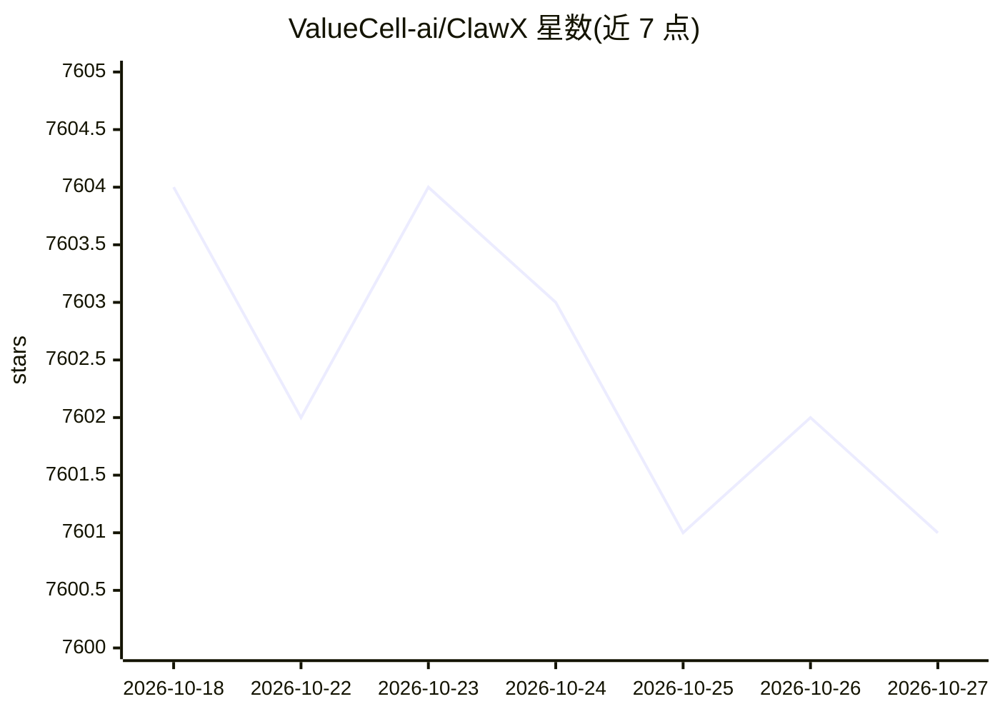

# ValueCell-ai/ClawX

⭐ 7,601 · TypeScript · MIT · 推送 2026-10-26 · [GitHub](https://github.com/ValueCell-ai/ClawX) · [官网](https://claw-x.com) · 组织维护 · 中文 README

**给普通用户的 OpenClaw AI agent 桌面图形界面客户端**

基于 Electron/React 的桌面应用，将 OpenClaw 的命令行 agent 编排转为图形界面操作，无需终端：内嵌 OpenClaw 官方运行时、引导式设置向导、多会话聊天、Agent 生命周期管理、Cron 定时任务、多渠道管理（微信/钉钉插件）、本地技能管理与文档处理技能。支持 OpenAI/Anthropic/Z.AI GLM 等多家模型供应商，凭据存于系统钥匙串；可选本地 Computer Use（捆绑 CUA CLI，默认关闭）。提供预编译安装包，也可从源码构建；另设企业版联系渠道。

## 筛选速览

| 维度 | 判定 | 备注 |
|---|---|---|
| AI 角色 | `ai-ecosystem` | LLM/agent 周边工具 |
| 许可风险 | `permissive` | MIT |
| 部署形态 | `desktop` | 安装包/桌面程序 |
| 模型依赖 | — | README 未给出锁定关系 |
| 硬件要求 | — | 无带数字的原话,不猜 |
| 安装摩擦 | `low` | 无编译、无系统依赖或容器化 |
| 成熟度 | — | 结构信号不足 |

## 能力要点

- 内嵌 OpenClaw 运行时，图形界面完成全部配置与 Gateway 生命周期管理
- 多模型供应商接入（OpenAI/Anthropic/Z.AI GLM/自定义），凭据存系统钥匙串
- Cron 定时任务、多渠道管理（含微信/钉钉官方插件）与本地技能系统
- 可选本地 Computer Use（捆绑 CUA CLI 0.25.0，默认关闭）

## 适用场景

- 不会用命令行的用户在桌面管理 OpenClaw AI agent
- 定时调度 agent 任务并把结果投递到微信/钉钉等渠道
- 通过统一面板配置多家模型供应商并管理技能

## 场景标签

`AI 助手` · 领域:对话与助手

## 证据(README 行号)

> L26: **ClawX** bridges the gap between powerful AI agents and everyday users. Built on top of OpenClaw, it transforms co
> L47: Building AI agents shouldn't require mastering the command line. ClawX was designed with a simple philosophy: **pow

## 星数曲线

2026-10-18 7,604 → 2026-10-27 7,601（-3）

---
*卡片 v1 · prompt 1.4 · 生成 2026-10-20 · 置信度 mid · 依据 README sha `4d96a072ce28` · [字段定义](../../DATASET.md)*
