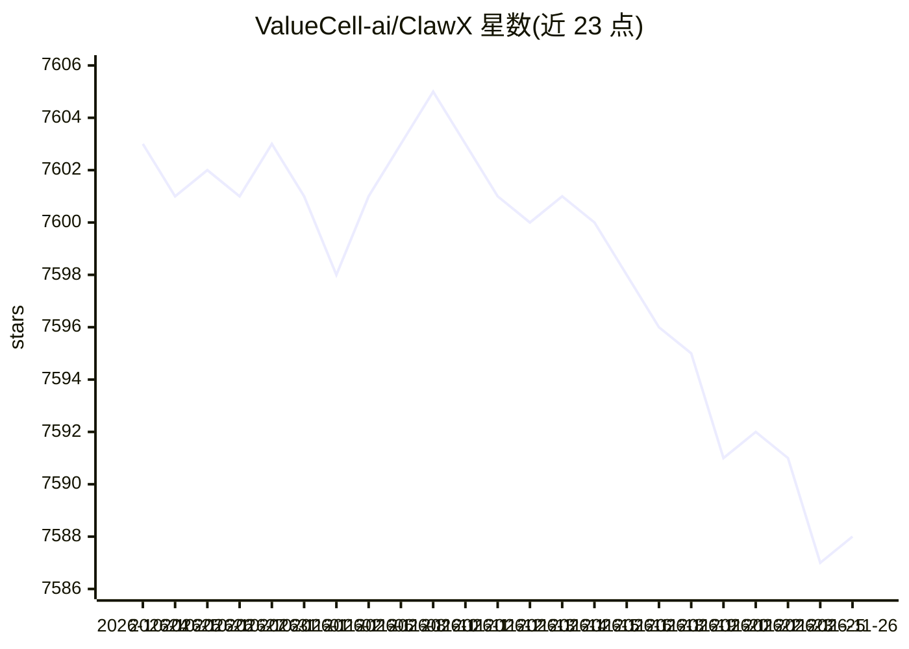

# ValueCell-ai/ClawX

⭐ 7,588 · TypeScript · MIT · 推送 2026-11-25 · [GitHub](https://github.com/ValueCell-ai/ClawX) · [官网](https://claw-x.com) · 组织维护 · 中文 README

**为 OpenClaw AI Agent 提供图形化桌面界面，免终端操作**

基于 Electron + React 的桌面应用，内嵌 OpenClaw 运行时，将命令行方式的 AI Agent 编排转为图形界面：提供引导式安装向导、可视化配置、Gateway 进程生命周期管理、多会话聊天界面、Agent 生命周期管理、技能本地管理与定时任务、多渠道（微信/钉钉）管理，以及 macOS/Windows 上的本地计算机操作驱动。支持 OpenAI、Anthropic 等多家模型服务商的统一配置，凭据存于系统密钥链。提供 Windows/macOS/Linux 预编译包，也可从源码构建。

## 筛选速览

| 维度 | 判定 | 备注 |
|---|---|---|
| AI 角色 | `ai-ecosystem` | LLM/agent 周边工具 |
| 许可风险 | `permissive` | MIT |
| 部署形态 | `desktop` | 安装包/桌面程序 |
| 模型依赖 | — | README 未给出锁定关系 |
| 硬件要求 | — | 无带数字的原话,不猜 |
| 安装摩擦 | `low` | 无编译、无系统依赖或容器化 |
| 成熟度 | — | 结构信号不足 |

## 能力要点

- 内嵌 OpenClaw 运行时，免终端完成配置与进程管理
- 多会话流式聊天界面，支持 Markdown/KaTeX、@agent 路由与 /skill 卡片
- Cron 定时任务与多渠道（腾讯微信/钉钉）消息投递
- 本地计算机使用（Computer Use）驱动：窗口、辅助功能与桌面操作

## 适用场景

- 不想用终端的用户在桌面配置和管理 OpenClaw Agent
- 定时让 Agent 监控信息源并把结果发到微信/钉钉
- 用桌面界面管理多个专用 Agent 与技能扩展包

## 场景标签

`GUI 自动化` · 领域:效率与自动化

## 证据(README 行号)

> L5:  The Desktop Interface for OpenClaw AI Agents
> L26: **ClawX** bridges the gap between powerful AI agents and everyday users. Built on top of OpenClaw, it transforms co
> L47: Building AI agents shouldn't require mastering the command line. ClawX was designed with a simple philosophy: **pow

## 星数曲线

2026-10-24 7,603 → 2026-11-26 7,588（-15）

---
*卡片 v1 · prompt 1.4 · 生成 2026-11-26 · 置信度 mid · 依据 README sha `fd80461d10d7` · [字段定义](../../DATASET.md)*
