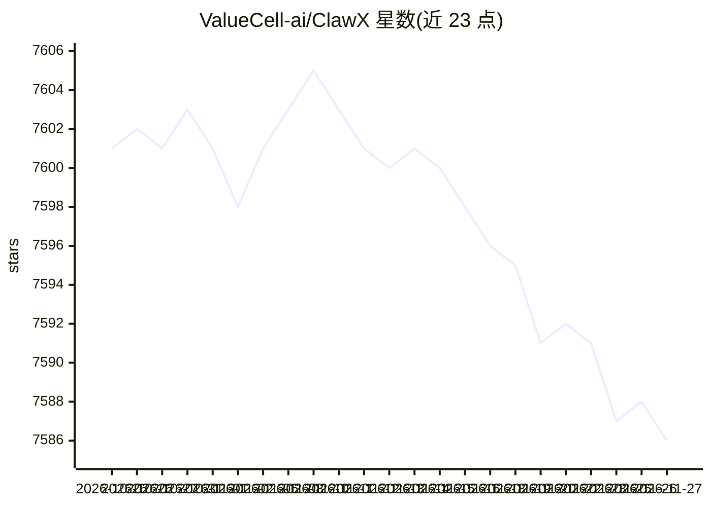

# ValueCell-ai/ClawX

⭐ 7,586 · TypeScript · MIT · 推送 2026-11-26 · [GitHub](https://github.com/ValueCell-ai/ClawX) · [官网](https://claw-x.com) · 组织维护 · 中文 README

**为 OpenClaw AI Agent 提供图形化桌面界面，免去命令行操作**

基于 Electron 与 React 构建的桌面应用，内嵌 OpenClaw 运行时，将命令行方式的 AI Agent 编排转为图形界面操作。功能覆盖多会话聊天、Agent 创建与生命周期管理、多渠道管理（含内置微信与钉钉插件）、Cron 定时任务、本地技能管理、模型提供商统一配置（凭据存入系统钥匙串）、语音听写与本地计算机操作。提供安装包与源码构建两种方式，最低 4GB 内存。另提供面向企业的商业版本联系方式。

## 筛选速览

| 维度 | 判定 | 备注 |
|---|---|---|
| AI 角色 | `ai-ecosystem` | LLM/agent 周边工具 |
| 许可风险 | `permissive` | MIT |
| 部署形态 | `desktop` | 安装包/桌面程序 |
| 模型依赖 | — | README 未给出锁定关系 |
| 硬件要求 | — | 无带数字的原话,不猜 |
| 安装摩擦 | `low` | 无编译、无系统依赖或容器化 |
| 成熟度 | — | 结构信号不足 |

## 能力要点

- 内嵌 OpenClaw 运行时，一键安装与向导式配置，无需终端命令
- 多渠道管理：内置腾讯个人微信插件与钉钉连接器
- Cron 定时任务与可本地管理的技能系统（pdf/xlsx/docx/pptx 技能）
- 凭据存入系统钥匙串的提供商集成与 macOS/Windows 本地计算机操作

## 适用场景

- 在桌面上配置和管理多个专用 AI Agent
- 定时让 Agent 监控信息源并把结果推送到微信/钉钉等渠道
- 把 Agent 接入开发流程做代码审查与文档生成
- 为不熟悉命令行的用户搭建 AI Agent 工作流

## 场景标签

`工作流自动化` `AI 助手` · 领域:效率与自动化

## 证据(README 行号)

> L26: **ClawX** bridges the gap between powerful AI agents and everyday users. Built on top of OpenClaw, it transforms co
> L47: Building AI agents shouldn't require mastering the command line. ClawX was designed with a simple philosophy: **pow
> L69: - **🔐 Secure Provider Integration**: Connect OpenAI, Anthropic, Z.AI / GLM, and other providers with credentials st

## 星数曲线

2026-10-25 7,601 → 2026-11-27 7,586（-15）

---
*卡片 v1 · prompt 1.4 · 生成 2026-11-27 · 置信度 mid · 依据 README sha `302c34238cbf` · [字段定义](../../DATASET.md)*
