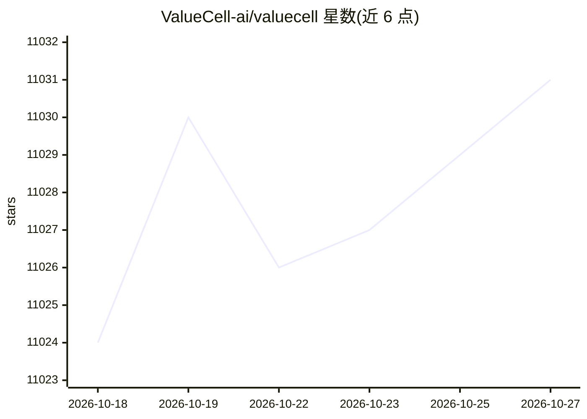

# ValueCell-ai/valuecell

⭐ 11,031 · Python · Apache-2.0 · 推送 2026-03-09 · [GitHub](https://github.com/ValueCell-ai/valuecell) · [官网](https://valuecell.ai) · 组织维护 · 中文 README

**面向金融投资的多 Agent 平台：选股、研究、跟踪与交易**

社区驱动的金融多 Agent 平台，提供 DeepResearch、策略交易、新闻检索等 Agent，覆盖美股、加密货币、港股、A股等市场数据，支持 Binance、OKX、Hyperliquid 等交易所的实盘合约交易路由（含内置护栏）。敏感信息与 API 密钥存储在本地设备。LLM 接入支持 OpenRouter、DeepSeek、Azure、OpenAI 等多家提供商；兼容 LangChain、Agno（A2A 协议）。用户可从 GitHub Releases 下载 macOS/Windows 应用，或克隆 Python 源码经脚本启动前后端与 agents，Web UI 访问 localhost:1420。

## 筛选速览

| 维度 | 判定 | 备注 |
|---|---|---|
| AI 角色 | `ai-native` | 本体是模型或模型工具 |
| 许可风险 | `permissive` | Apache-2.0 |
| 部署形态 | `desktop` | 安装包/桌面程序 |
| 模型依赖 | locked-api |  |
| 硬件要求 | — | 无带数字的原话,不猜 |
| 安装摩擦 | `low` | 无编译、无系统依赖或容器化 |
| 成熟度 | — | 结构信号不足 |

## 能力要点

- 多 Agent 系统：DeepResearch、策略交易、定时新闻检索
- 多 LLM 提供商接入（OpenRouter/DeepSeek/Azure/OpenAI 等）
- Binance/OKX/Hyperliquid 等交易所实盘路由并内置护栏
- 敏感数据与 API 密钥本地存储

## 适用场景

- 让投资 Agent 帮我做股票研究与标的分析
- 配置 AI 模型与交易所 API 进行加密货币合约策略交易
- 定时接收个性化市场新闻与关键信息跟踪

## 场景标签

`金融量化` `多智能体` · 领域:Agent 开发

## 证据(README 行号)

> L37: ValueCell is a community-driven, multi-agent platform for financial applications. Our mission is to build the world
> L54: - **DeepResearch Agent**: Automatically retrieve and analyze fundamental documents to generate accurate data insigh
> L60: - **Multiple LLM Providers**: Support OpenRouter, SiliconFlow,Azure,Openai-compatible,Google,OpenAI and DeepSeek

## 星数曲线

2026-10-18 11,024 → 2026-10-27 11,031（+7）

---
*卡片 v1 · prompt 1.4 · 生成 2026-10-20 · 置信度 high · 依据 README sha `e59369b9df9f` · [字段定义](../../DATASET.md)*
