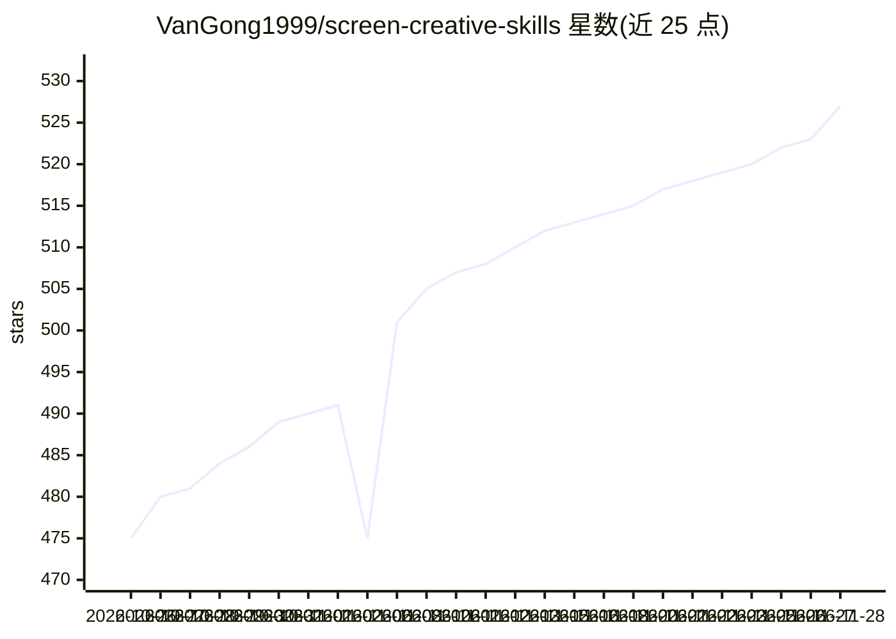

# VanGong1999/screen-creative-skills

⭐ 527 · Python · MIT · 推送 2026-11-22 · [GitHub](https://github.com/VanGong1999/screen-creative-skills) · 个人维护 · 中文 README

**影视创作者的 31 个 AI 剧本评估与策划技能集**

以 Agent Skills 开放格式（SKILL.md + references/）组织的影视剧本创作与评估技能集合，共 31 个，分十个类别：小说初筛、故事分析、人物分析、评估筛选、创作策划、剧集拉片、工作流编排、结果处理、文本工具与知识检索。每个环节可单独调用，也可按内容类型组合为工作流。兼容 Claude Code、Cursor、Codex 三端，提供安装脚本软链到对应 skills 目录与结构校验脚本，配套公众号提供使用教程。

## 筛选速览

| 维度 | 判定 | 备注 |
|---|---|---|
| AI 角色 | `ai-knowledge` | 知识聚合/清单类 |
| 许可风险 | `permissive` | MIT |
| 部署形态 | `None` |  |
| 模型依赖 | — | README 未给出锁定关系 |
| 硬件要求 | — | 无带数字的原话,不猜 |
| 安装摩擦 | `low` | 无编译、无系统依赖或容器化 |
| 成熟度 | — | 结构信号不足 |

## 能力要点

- 31 个技能覆盖小说初筛到剧本创作全流程，分十个类别
- 兼容 Claude Code / Cursor / Codex 的 Agent Skills 开放格式
- 提供 install-skills.sh 一键软链安装与 validate-skills.py 结构校验
- 含工作流编排类技能（drama-workflow、plot-workflow）串联子技能调用链

## 适用场景

- 网文平台每日批量筛选小说投稿并评估改编潜力
- 影视公司 IP 采购与项目立项的多维度评估
- 创作竖屏短剧或长剧剧本的大纲与人物小传
- 拆解已播爆款剧集做拉片分析学习

## 场景标签

`AI 写作` · 领域:内容生成

## 证据(README 行号)

> L5: > 31 个专业 AI Skills，涵盖从小说筛选到剧本创作的全流程能力
> L9: > 兼容：**Claude Code** · **Cursor** · **Codex**（Agent Skills 开放格式）
> L318: 本仓库每个 skill 都是标准 Agent Skills 目录（`SKILL.md` + 可选 `references/`），三端可共用。用安装脚本一键软链到对应目录即可（推荐，升级仓库后自动生效）。

## 星数曲线

2026-10-26 475 → 2026-11-28 527（+52）

---
*卡片 v1 · prompt 1.4 · 生成 2026-11-25 · 置信度 high · 依据 README sha `960328b99ee3` · [字段定义](../../DATASET.md)*
