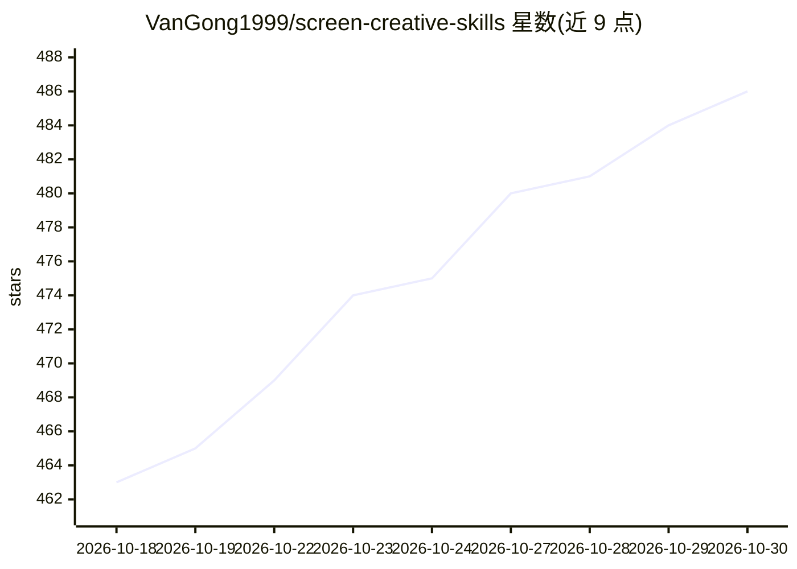

# VanGong1999/screen-creative-skills

⭐ 486 · Python · MIT · 推送 2026-10-20 · [GitHub](https://github.com/VanGong1999/screen-creative-skills) · 个人维护 · 中文 README

**31 个影视创作评估策划 Agent Skills 合集，供 Claude Code/Cursor/Codex 使用**

面向影视创作者、策划师与内容评估师的 Agent Skills 集合，共 31 个 SKILL.md 格式技能，按小说初筛、故事分析、人物分析、评估筛选、创作策划、剧集拉片、工作流编排、结果处理、工具辅助、知识检索十类组织，覆盖竖屏短剧、中长剧、长剧/电视剧、电影剧本与 IP 改编流程。遵循开放 Agent Skills 格式，兼容 Claude Code、Cursor、Codex 三端，提供安装脚本软链到各平台技能目录，并有 Python 校验脚本检查 frontmatter、链接与命名。维护者为个人（宫承瑞），附带公众号与关联仓库。

## 筛选速览

| 维度 | 判定 | 备注 |
|---|---|---|
| AI 角色 | `ai-knowledge` | 知识聚合/清单类 |
| 许可风险 | `permissive` | MIT |
| 部署形态 | `None` |  |
| 模型依赖 | — | README 未给出锁定关系 |
| 硬件要求 | — | 无带数字的原话,不猜 |
| 安装摩擦 | `low` | 无编译、无系统依赖或容器化 |
| 成熟度 | — | 结构信号不足 |

## 能力要点

- 31 个 SKILL.md 格式技能，按 10 类组织
- 兼容 Claude Code / Cursor / Codex 三端，一键软链安装
- 提供 install-skills.sh 安装脚本与 validate-skills.py 结构校验脚本
- 按内容类型（短剧/中长剧/长剧/电影）给出推荐工作流组合

## 适用场景

- 用 AI agent 批量筛选网络小说并评估改编潜力
- 生成竖屏短剧策划与剧本初稿
- 对电影剧本做三维度评估与人物小传生成
- 对已播爆款剧集做拉片与五元素分析

## 场景标签

`AI 写作` `提示工程` · 领域:Agent 开发

## 证据(README 行号)

> L5: > 31 个专业 AI Skills，涵盖从小说筛选到剧本创作的全流程能力
> L9: > 兼容：**Claude Code** · **Cursor** · **Codex**（Agent Skills 开放格式）
> L312: 本仓库每个 skill 都是标准 Agent Skills 目录（`SKILL.md` + 可选 `references/`），三端可共用。用安装脚本一键软链到对应目录即可（推荐，升级仓库后自动生效）。

## 星数曲线

2026-10-18 463 → 2026-10-30 486（+23）

---
*卡片 v1 · prompt 1.4 · 生成 2026-10-21 · 置信度 high · 依据 README sha `7d4500b4ac12` · [字段定义](../../DATASET.md)*
