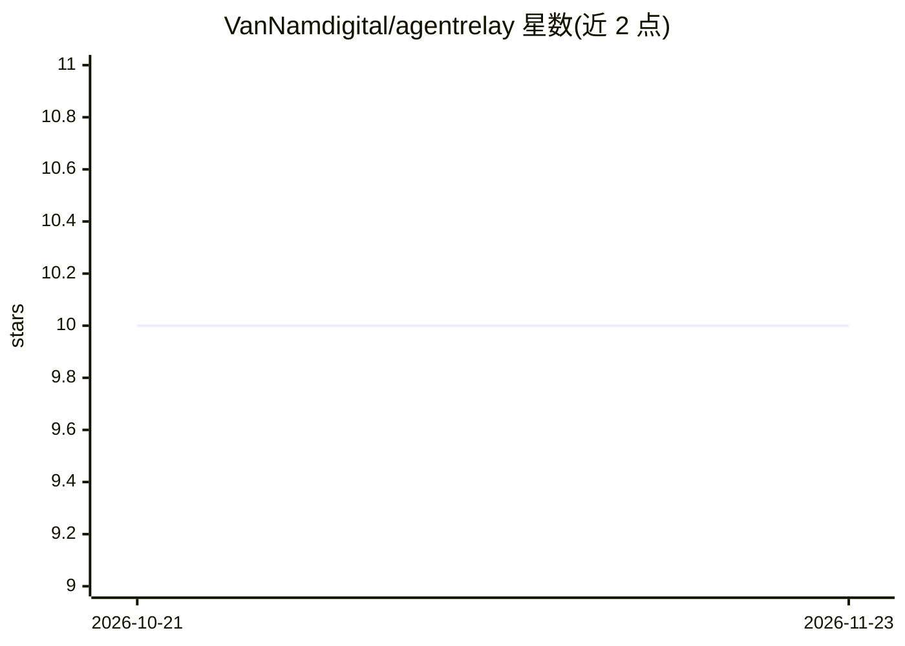

# VanNamdigital/agentrelay

⭐ 10 · JavaScript · MIT · 推送 2026-05-21 · [GitHub](https://github.com/VanNamdigital/agentrelay) · [官网](https://github.com/VanNamdigital/agentrelay) · 个人维护

**本地运行的 Telegram 机器人与管理面板，控制本机 AI CLI 提供者**

本地优先的 Node.js 工具：通过 Telegram 机器人和本地管理面板（127.0.0.1:3456）从自己的机器上控制 AI CLI 提供者。功能包括按用户 ID 的 Telegram 访问控制、SQLite 存储的设置/项目/机器人频道/提供者与模型注册表、跨 PATH 与常见安装位置的异步 CLI 检测、日志与任务摘要中的密钥脱敏、默认仅绑定 localhost。官方声明目前仅 OpenCode CLI 作为 Telegram 提示运行时经过验证，其他 CLI 运行器为实验状态。适用于个人本地使用，明确要求不要直接暴露到互联网。

## 筛选速览

| 维度 | 判定 | 备注 |
|---|---|---|
| AI 角色 | `ai-ecosystem` | LLM/agent 周边工具 |
| 许可风险 | `permissive` | MIT |
| 部署形态 | `library` | 以包/库形式分发 |
| 模型依赖 | — | README 未给出锁定关系 |
| 硬件要求 | — | 无带数字的原话,不猜 |
| 安装摩擦 | `low` | 无编译、无系统依赖或容器化 |
| 成熟度 | — | 结构信号不足 |

## 能力要点

- Telegram 机器人按用户 ID 做访问控制
- SQLite 存储设置、项目、提供者与模型注册表
- 异步检测 PATH 与常见安装位置的本地 CLI
- 日志、设置视图与任务摘要中的密钥脱敏

## 适用场景

- 通过 Telegram 在手机上向本机 AI CLI 发送提示
- 在本地面板统一管理多个 AI CLI 工具与模型
- 个人本地环境下对 AI CLI 使用做访问控制

## 场景标签

`编码 Agent` · 领域:编码与开发

## 证据(README 行号)

> L7: AgentRelay is a local-first Telegram bot and admin dashboard for controlling AI CLI providers from your own machine.
> L11: > Runtime support note: OpenCode CLI is the currently verified Telegram prompt runtime. Other CLI runners are being

## 星数曲线

2026-10-21 10 → 2026-11-23 10（+0）

---
*卡片 v1 · prompt 1.4 · 生成 2026-11-20 · 置信度 high · 依据 README sha `d8072dc8e141` · [字段定义](../../DATASET.md)*
