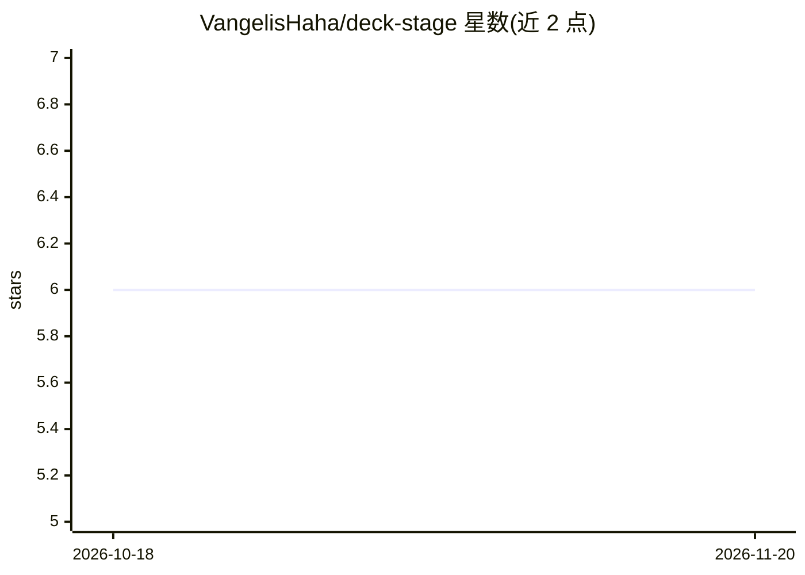

# VangelisHaha/deck-stage

⭐ — · [GitHub]() · 个人维护 · 中文 README

**给 Agent 产出的 HTML 演示稿提供 macOS/Windows 放映壳**

DeckStage 是一个桌面放映应用，负责播放由 AI Agent 用 HTML 编写的演示稿：提供无浏览器痕迹的观众窗口、双屏投屏、演讲者视图（台词、计时、缩略图）、手机浏览器遥控与访客同屏、稿库管理与 SSH 远端稿库。本体不编辑稿子，配套 deck-html skill 安装到 Agent（如 Claude Code）后由 Agent 生成与修改稿子，并通过 deckstage:// 链接与应用互动。可导出 ZIP 或逐页截图的 PPTX。仅 macOS 13 Intel 真机验证过，Windows 验收未完成。

## 筛选速览

| 维度 | 判定 | 备注 |
|---|---|---|
| AI 角色 | `ai-enhanced` | 去掉 AI 部分产品仍成立 |
| 许可风险 | `permissive` | — |
| 部署形态 | `desktop` | 安装包/桌面程序 |
| 模型依赖 | — | README 未给出锁定关系 |
| 硬件要求 | — | 无带数字的原话,不猜 |
| 安装摩擦 | `medium` | 含编译或系统依赖之一 |
| 成熟度 | `idea` | |

## 能力要点

- 双窗口放映：观众窗口与演讲者视图翻页自动同步
- 手机浏览器扫码遥控与访客同屏，免装 App
- 配套 deck-html skill，Agent 写稿后经 deckstage:// 链接互动
- 导出 ZIP（浏览器可开）或逐页截图 PPTX

## 适用场景

- 让 Agent 生成演示稿后用无浏览器痕迹的壳放映
- 双屏演讲时用演讲者视图看台词、计时和下一页预览
- 手机扫码翻页控制放映
- 把稿子导出发给没装本应用的观众

## 场景标签

 · 领域:办公/演示工具

## 证据(README 行号)

> L7: DeckStage 是一个支持 macOS 和 Windows 的桌面放映应用，配一个给 Agent 用的 skill。Agent 用 HTML 写演示稿，DeckStage 负责把它放出来：无浏览器痕迹、双屏、演讲者视图、手机遥控
> L239: DeckStage 不编辑稿子，新建和修改都由 Agent 用配套的 deck-html skill 完成。稿库左下角会显示 skills 目录和一段「安装提示词」，复制给任意 Agent，它会：

## 星数曲线

2026-10-18 6 → 2026-11-20 6（+0）

---
*卡片 v1 · prompt 1.4 · 生成 2026-11-20 · 置信度 high · 依据 README sha `d0860ddebc1b` · [字段定义](../../DATASET.md)*
