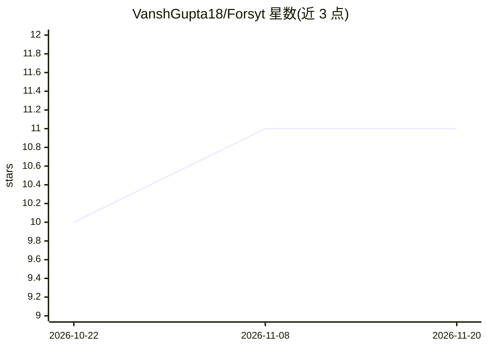

# VanshGupta18/Forsyt

⭐ 11 · Python · MIT · 推送 2026-11-19 · [GitHub](https://github.com/VanshGupta18/Forsyt) · [官网](https://forsyt.vercel.app) · 个人维护

**面向印度市场的每日地缘政治风险指数与仪表盘平台**

从 9 个印度新闻源抓取 RSS 标题，经 NLP 打标（sentence-transformer 主题分类、词表语气评分、正则地名匹配）后聚合成每日印度 GPR 风险指数与 12 条贸易走廊评分，并提供 Flask API 与 6 页 React 仪表盘，地缘风险与 NIFTY 波动率并列展示。数据管道由 GitHub Actions 定时运行，本地只需启动 API 与前端；作者声明这是毕设项目，非生产级金融产品，投资组合页仅为示例展示。

## 筛选速览

| 维度 | 判定 | 备注 |
|---|---|---|
| AI 角色 | `ai-native` | 本体是模型或模型工具 |
| 许可风险 | `permissive` | MIT |
| 部署形态 | `library` | 以包/库形式分发 |
| 模型依赖 | — | README 未给出锁定关系 |
| 硬件要求 | — | 无带数字的原话,不猜 |
| 安装摩擦 | `low` | 无编译、无系统依赖或容器化 |
| 成熟度 | — | 结构信号不足 |

## 能力要点

- 每日印度 GPR 指数，对标 Caldara-Iacoviello 方法校准
- 12 条贸易走廊独立风险评分，按真实贸易敞口加权
- sentence-transformer 主题分类 + 词表语气评分 + 正则地名匹配
- GitHub Actions 全自动云管道，本地无需跑采集与打分

## 适用场景

- 查看每日印度地缘政治风险等级与走廊评分
- 按主题筛选带标签的印度新闻情报流
- 对照地缘风险与 NIFTY 波动率的双重信号面板

## 场景标签

`金融量化` · 领域:学习与行业

## 证据(README 行号)

> L46: - **NLP tagging** — every article gets a theme classification (sentence-transformer embedding match), a tone/GCAM s
> L47: - **India GPR Index** — a daily normalized geopolitical risk score, built with the same scoring method as the acade
> L79: - a **theme** (sentence-transformer similarity match against ~24 GDELT-style taxonomy codes like `ARMEDCONFLICT`, `

## 星数曲线

2026-10-22 10 → 2026-11-20 11（+1）

---
*卡片 v1 · prompt 1.4 · 生成 2026-11-18 · 置信度 high · 依据 README sha `960e95d7699d` · [字段定义](../../DATASET.md)*
