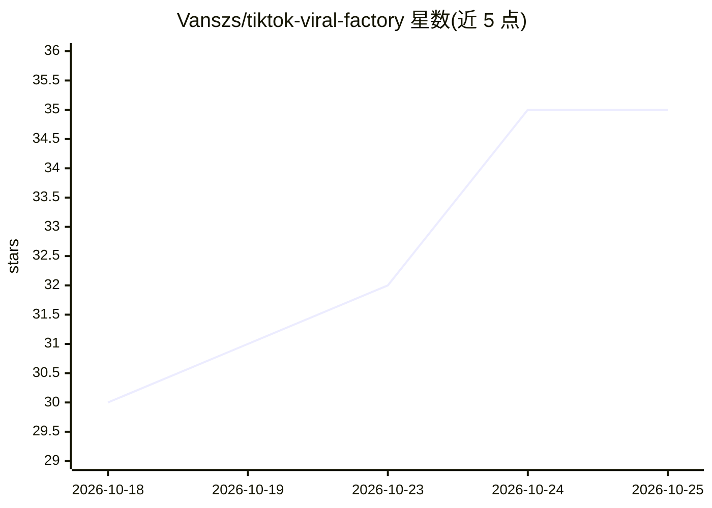

# Vanszs/tiktok-viral-factory

⭐ 35 · Python · 推送 2026-06-22 · [GitHub](https://github.com/Vanszs/tiktok-viral-factory) · 个人维护

**全自动多 Agent 系统生成并发布 TikTok 带货视频**

基于 LangGraph 的多 Agent 自动化系统：7 个 Agent 协作完成选品调研、内容策略、脚本撰写、Kling AI 产品镜头生成、FFmpeg 视频合成（ElevenLabs 配音 + Pixabay/Pexels 素材 + 字幕）、SEO 优化与 TikTok API 发布，面向 TikTok Shop 联盟营销的美妆个护垂类。LLM 层为 OpenAI 兼容 API，可接 OpenAI/Groq/Together/Ollama。需自备各服务 API key，Python 3.11+ 与 FFmpeg，按 README 估算月产 100 条视频成本约 $50。

## 筛选速览

| 维度 | 判定 | 备注 |
|---|---|---|
| AI 角色 | `ai-native` | 本体是模型或模型工具 |
| 许可风险 | `none` | — |
| 部署形态 | `library` | 以包/库形式分发 |
| 模型依赖 | local-ok | 支持本地模型 |
| 硬件要求 | — | 无带数字的原话,不猜 |
| 安装摩擦 | `medium` | 含编译或系统依赖之一 |
| 成熟度 | — | 结构信号不足 |

## 能力要点

- 7 个 LangGraph Agent：Supervisor/Research/Strategy/Script/SEO/Producer/Publisher/Analytics
- 混合视频管线：60% 素材库 + 20% Kling AI 镜头 + 20% 覆盖层，规避 TikTok AI 内容限流
- 逐词时间戳的卡拉 OK 式字幕、内容去重与实时成本追踪
- MCP Bridge 可接入任意 MCP server 并将 Agent 暴露为工具

## 适用场景

- 批量生产 TikTok Shop 联盟带货短视频
- 美妆个护垂类的自动选品与内容排期
- 接入自有 LLM 与工具生态跑自动化视频流水线

## 场景标签

`多智能体` `视频生成` · 领域:Agent 开发

## 证据(README 行号)

> L5:  Multi-Agent AI System that generates, produces, and publishes TikTok Shop Affiliate videos — fully automated.
> L20: A **fully autonomous AI workforce** that runs 7 specialized agents working together to:
> L25: 4. **Generate** product hero shots using Kling AI (cinematic, not AI slop)

## 星数曲线

2026-10-18 30 → 2026-10-25 35（+5）

---
*卡片 v1 · prompt 1.4 · 生成 2026-10-25 · 置信度 high · 依据 README sha `7e282ed26154` · [字段定义](../../DATASET.md)*
