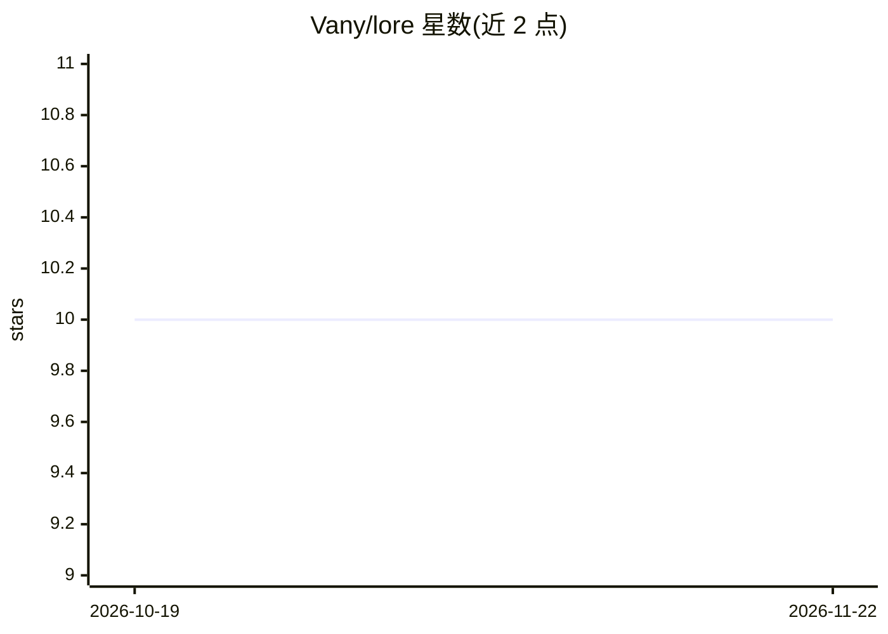

# Vany/lore

⭐ 10 · TypeScript · MIT · 推送 2026-10-22 · [GitHub](https://github.com/Vany/lore) · 个人维护

**跨模型代码审查服务：分支合并前评审并跨会话记住代码库事实**

面向开发团队的代码审查服务，在分支合并前按分层阶梯执行评审：先运行仓库自身的确定性工具（tsc/ESLint/semgrep 等），再依次调用三家厂商的模型。核心机制是持久化记忆：评审中确立的事实与理由按仓库存储、带过期机制，并在后续会话中复用；被驳回的理由会以更高严重级重新呈现。通过 MCP 协议向 Claude Code、Cursor 等客户端代理暴露接口，以退出码作为程序化 API，并提供 Web 面板查看评审状态。限制：评审模型刻意排除 Anthropic，计量付费路由默认关闭。

## 筛选速览

| 维度 | 判定 | 备注 |
|---|---|---|
| AI 角色 | `ai-ecosystem` | LLM/agent 周边工具 |
| 许可风险 | `permissive` | MIT |
| 部署形态 | `None` |  |
| 模型依赖 | — | README 未给出锁定关系 |
| 硬件要求 | — | 无带数字的原话,不猜 |
| 安装摩擦 | `low` | 无编译、无系统依赖或容器化 |
| 成熟度 | — | 结构信号不足 |

## 能力要点

- 分层评审阶梯：确定性工具免费层 + 三家厂商模型各占一层
- lore-ok 标注机制：代码内理由经评审核准后成为共享记忆并可过期
- 评审者与作者模型隔离，不部署 Anthropic 凭据
- 以 MCP 提供工具与文档，退出码区分通过/未运行/配额耗尽

## 适用场景

- 团队共享部署，让评审结论在新会话中不被重复提出
- 在合并前以独立于代码作者的模型审查分支
- 通过退出码把评审接入 CI 或自动化流程

## 场景标签

`代码审查` `Agent 记忆` · 领域:Agent 开发

## 证据(README 行号)

> L18: **`lore` is the memory.** It reviews a branch before it merges — with models that did not
> L150: |push a branch and ask for a review|runs your own `tsc`, ESLint, `semgrep`, `ast-grep`, then up to three models fr
> L195: paste** into that person's Claude Code, Cursor, or any other MCP client. Nothing else is

## 星数曲线

2026-10-19 10 → 2026-11-22 10（+0）

---
*卡片 v1 · prompt 1.4 · 生成 2026-11-20 · 置信度 high · 依据 README sha `834cfbc7690c` · [字段定义](../../DATASET.md)*
