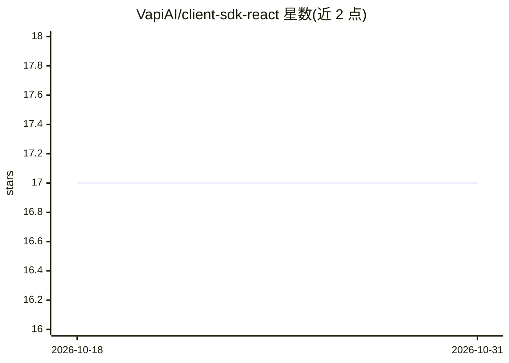

# VapiAI/client-sdk-react

⭐ 17 · TypeScript · MIT · 推送 2026-10-27 · [GitHub](https://github.com/VapiAI/client-sdk-react) · [官网](https://vapi.ai/) · 组织维护

**React 语音/聊天 AI 组件库：为网站嵌入 VAPI 语音助手**

基于 Vite、TypeScript 和 Tailwind CSS 的 React 组件库，提供可嵌入的 VapiWidget 组件与 HTML 自定义元素，实现与 VAPI AI 助手的实时语音通话、文本聊天及混合模式。支持主题、颜色、尺寸、位置等界面定制，内置合规用同意表单，提供语音通话自动重连（session/cookies 两种作用域）与事件回调。需 VAPI 账户、API key 与 @vapi-ai/web 对等依赖；语音模式需麦克风权限，生产环境要求 HTTPS。README 声明目前为 Beta 版本，API 可能变动。

## 筛选速览

| 维度 | 判定 | 备注 |
|---|---|---|
| AI 角色 | `ai-ecosystem` | LLM/agent 周边工具 |
| 许可风险 | `permissive` | MIT |
| 部署形态 | `library` | 以包/库形式分发 |
| 模型依赖 | — | README 未给出锁定关系 |
| 硬件要求 | — | 无带数字的原话,不猜 |
| 安装摩擦 | `low` | 无编译、无系统依赖或容器化 |
| 成熟度 | `idea` | |

## 能力要点

- 语音/聊天/混合三种交互模式，可在通话中切换
- 支持 React 组件、HTML 自定义元素与 data 属性三种嵌入方式
- 内置同意表单与语音通话自动重连（session/cookies 作用域）
- 主题、颜色、尺寸、位置等界面配置项

## 适用场景

- 在 React 网站中嵌入 AI 语音客服或聊天挂件
- 为非 React 页面通过自定义元素接入语音助手
- 需要用户同意条款合规的语音交互场景

## 场景标签

`语音 Agent` · 领域:对话与助手

## 证据(README 行号)

> L5: A modern React component library with embeddable voice and chat widgets built with Vite, TypeScript, and Tailwind CS
> L9: - 🎙️ **Voice Conversations**: Real-time voice calls with VAPI AI assistants

## 星数曲线

2026-10-18 17 → 2026-10-31 17（+0）

---
*卡片 v1 · prompt 1.4 · 生成 2026-10-29 · 置信度 high · 依据 README sha `b3fb9d67a79b` · [字段定义](../../DATASET.md)*
