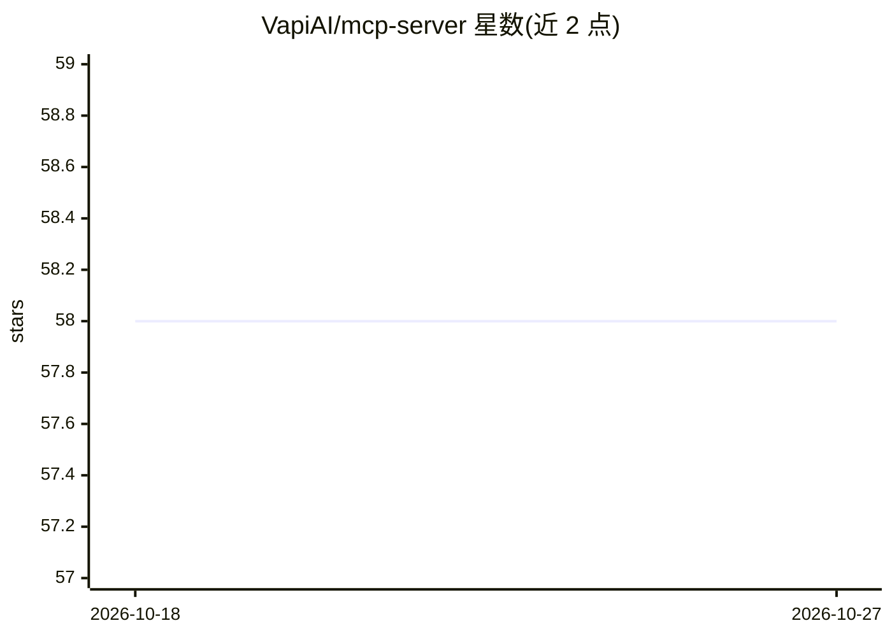

# VapiAI/mcp-server

⭐ 58 · TypeScript · MIT · 推送 2026-10-11 · [GitHub](https://github.com/VapiAI/mcp-server) · [官网](https://vapi.ai/) · 组织维护

**让 MCP 客户端通过 Vapi 创建语音助手与拨打电话的服务器**

Vapi 官方的 MCP 服务器，使 Claude Code、Claude Desktop 等 MCP 客户端能够操作 Vapi 语音平台：管理助手（列表/创建/更新）、发起即时或定时外呼、查询通话记录、管理电话号码与函数调用工具。支持本地 stdio（npx 运行，需设置 VAPI_TOKEN）与远程 Streamable HTTP 两种接入方式，SSE 端点已标记弃用。另附带可安装到编码代理的 Agent Skill 文件。

## 筛选速览

| 维度 | 判定 | 备注 |
|---|---|---|
| AI 角色 | `ai-ecosystem` | LLM/agent 周边工具 |
| 许可风险 | `permissive` | MIT |
| 部署形态 | `library` | 以包/库形式分发 |
| 模型依赖 | — | README 未给出锁定关系 |
| 硬件要求 | — | 无带数字的原话,不猜 |
| 安装摩擦 | `low` | 无编译、无系统依赖或容器化 |
| 成熟度 | — | 结构信号不足 |

## 能力要点

- 本地 stdio（npx）与远程 Streamable HTTP 两种接入方式
- 12 个工具覆盖助手管理、外呼、通话记录、电话号码与函数工具
- create_call 支持动态变量（variableValues）与定时外呼
- 附带给 AI 编码代理的 Agent Skill 安装说明

## 适用场景

- 通过 Claude 等 MCP 客户端用自然语言创建和管理 Vapi 语音助手
- 让 AI 代理发起即时或预约的外呼电话
- 查询通话历史与助手配置细节

## 场景标签

`语音 Agent` · 领域:对话与助手

## 证据(README 行号)

> L3: Build AI voice assistants and phone agents with Vapi using the Model Context Protocol.
> L30: - URL: `https://mcp.vapi.ai/mcp`
> L127: ### Assistants

## 星数曲线

2026-10-18 58 → 2026-10-27 58（+0）

---
*卡片 v1 · prompt 1.4 · 生成 2026-10-24 · 置信度 high · 依据 README sha `206228849355` · [字段定义](../../DATASET.md)*
