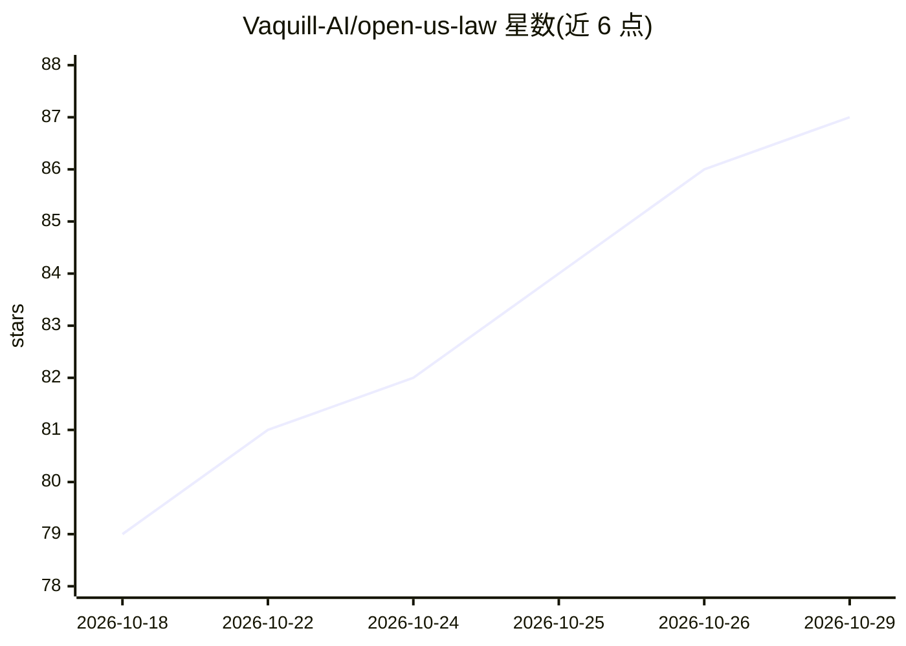

# Vaquill-AI/open-us-law

⭐ 87 · Python · Apache-2.0 · 推送 2026-10-12 · [GitHub](https://github.com/Vaquill-AI/open-us-law) · [官网](https://huggingface.co/datasets/vaquill/open-us-law) · 组织维护

**美国成文法结构化开放语料库：509万条法条及采集管线**

由 Vaquill AI 维护的美国一级法律开放语料：收录 5,081,709 条法律条节，覆盖州成文法、美国法典、CFR、州行政法规、州宪法与法院规则等，统一为 27 列 Parquet 模式（含引用、层级、生效状态、官方来源 URL），季度快照发布于 Hugging Face 并镜像至 R2。仓库同时公开全部爬虫与批量摄取脚本（Apache-2.0），输出 JSONL，可复现可审计。数据许可为 CC BY-NC 4.0，非商业用途免费，商业许可需联系团队；部分州来源限美国境内访问。

## 筛选速览

| 维度 | 判定 | 备注 |
|---|---|---|
| AI 角色 | `ai-knowledge` | 知识聚合/清单类 |
| 许可风险 | `permissive` | Apache-2.0 |
| 部署形态 | `library` | 以包/库形式分发 |
| 模型依赖 | — | README 未给出锁定关系 |
| 硬件要求 | — | 无带数字的原话,不猜 |
| 安装摩擦 | `low` | 无编译、无系统依赖或容器化 |
| 成熟度 | — | 结构信号不足 |

## 能力要点

- 5,081,709 条条节、308 个文件，统一 27 列模式
- 覆盖 50 州+DC+波多黎各的成文法与各联邦语料
- 全部爬虫与批量摄取脚本开源（Apache-2.0），输出 JSONL
- 每条条节携带政府出版方回链与 act_status 生效状态

## 适用场景

- 法律检索与研究使用免费结构化法条数据
- 构建法律 AI/RAG 系统的训练或检索语料
- 复现与审计语料的采集管线
- 法律援助、教学、新闻等非商业场景查阅原始法条

## 场景标签

 · 领域:法律/开放数据

## 证据(README 行号)

> L3: **Open, structured US primary law - plus the scrapers that build it.**
> L52: The built snapshot is published on Hugging Face. **You do not need to run any of the scrapers below to use it** - t
> L78: Parquet, one 27-column schema across every jurisdiction (the 24 columns of earlier snapshots, unchanged, plus `offi

## 星数曲线

2026-10-18 79 → 2026-10-29 87（+8）

---
*卡片 v1 · prompt 1.4 · 生成 2026-10-24 · 置信度 high · 依据 README sha `a356cd7d51da` · [字段定义](../../DATASET.md)*
