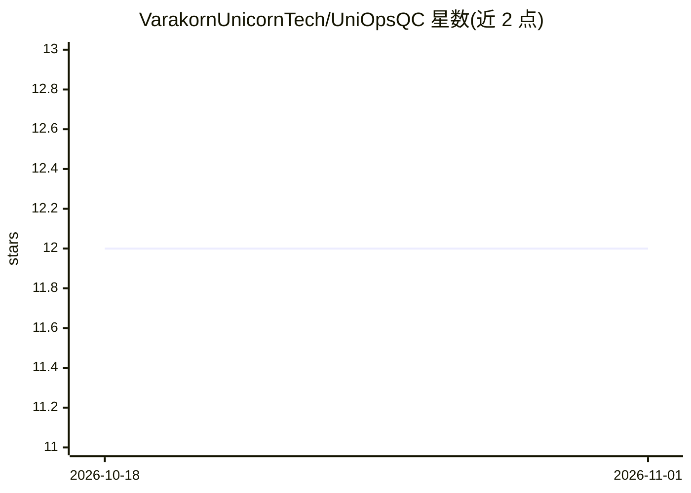

# VarakornUnicornTech/UniOpsQC

⭐ 12 · Shell · MIT · 推送 2026-09-21 · [GitHub](https://github.com/VarakornUnicornTech/UniOpsQC) · [官网](https://www.unicorntechint.com) · 组织维护

**把 Claude Code 组织成多团队治理结构的工作流框架**

面向 Claude Code 的多团队 AI 治理框架模板：以 5 个团队、16 个专职角色的分层结构改造 Claude Code 的默认单一助手模式，提供阶段门控的工单驱动工作流、21 个斜杠命令（如 /git commit、/git pr、/team-start）、9 项策略与基于 hooks 的自动执行（编辑前检查工单、变更日志、受保护文件拦截）。安装方式为让 Claude Code 直接安装或 git clone 后复制 .claude/ 目录；Windows 上 hook 脚本要求 bash 与 jq。由 Unicorn Tech Integration Co., Ltd. 维护，另有配套 VSCode 扩展 UniOpsQC Hub 作为命令启动器与日志查看器。

## 筛选速览

| 维度 | 判定 | 备注 |
|---|---|---|
| AI 角色 | `ai-ecosystem` | LLM/agent 周边工具 |
| 许可风险 | `permissive` | MIT |
| 部署形态 | `library` | 以包/库形式分发 |
| 模型依赖 | — | README 未给出锁定关系 |
| 硬件要求 | — | 无带数字的原话,不猜 |
| 安装摩擦 | `low` | 无编译、无系统依赖或容器化 |
| 成熟度 | — | 结构信号不足 |

## 能力要点

- 5 团队 16 角色的分层组织结构与阶段门控工单工作流
- 21 个斜杠命令覆盖工作流、规划、质量与框架管理
- hooks 自动执行：工单存在性检查、变更日志、受保护文件拦截
- 配套 VSCode 扩展 UniOpsQC Hub（命令启动与日志查看）

## 适用场景

- 给 Claude Code 加上治理门控后再提交代码和 PR
- 以团队/角色模拟方式管理多阶段项目开发
- 为 AI 编码过程保留可追溯的会话与决策审计日志

## 场景标签

`工作流自动化` `编码 Agent` `多智能体` · 领域:Agent 开发

## 证据(README 行号)

> L29: > **Governance for Claude Code — ship with confidence, not just speed.**
> L30: > A structured multi-team AI governance framework that turns Claude Code into a coordinated engineering organizatio

## 星数曲线

2026-10-18 12 → 2026-11-01 12（+0）

---
*卡片 v1 · prompt 1.4 · 生成 2026-11-01 · 置信度 mid · 依据 README sha `042229b546e6` · [字段定义](../../DATASET.md)*
