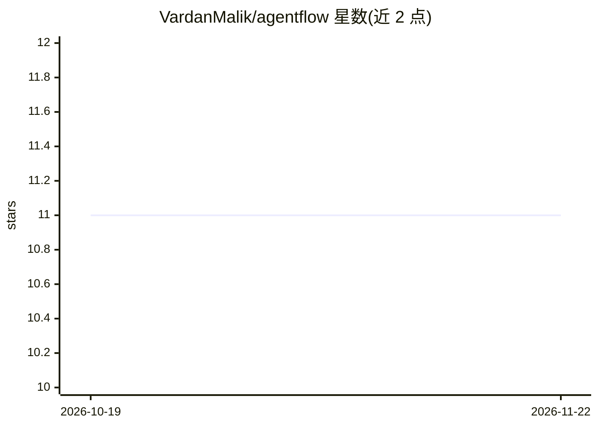

# VardanMalik/agentflow

⭐ 11 · Python · MIT · 推送 2026-05-21 · [GitHub](https://github.com/VardanMalik/agentflow) · 个人维护

**分布式多 agent 编排平台：容错执行多步 LLM 工作流**

基于 FastAPI + Celery/Redis 的分布式 agent 编排平台，支持顺序与并行步骤执行，内置重试（指数退避）、熔断、舱壁隔离与死信队列等容错模式，通过 OpenTelemetry、Prometheus、Grafana 与结构化日志提供追踪、指标、日志三大观测支柱，并配备 React + TypeScript 实时仪表盘。作者自述为作品集项目，刻意控制范围，面向生产工作负载场景。

## 筛选速览

| 维度 | 判定 | 备注 |
|---|---|---|
| AI 角色 | `ai-ecosystem` | LLM/agent 周边工具 |
| 许可风险 | `permissive` | MIT |
| 部署形态 | `self-host` | docker 或自建部署 |
| 模型依赖 | — | README 未给出锁定关系 |
| 硬件要求 | — | 无带数字的原话,不猜 |
| 安装摩擦 | `low` | 无编译、无系统依赖或容器化 |
| 成熟度 | `idea` | |

## 能力要点

- Celery + Redis 分布式任务队列，支持顺序与并行步骤执行
- 四种专用 agent（Research/Analysis/Writer/Code）及可扩展基类
- 经 LiteLLM 网关接入任意 LLM provider（OpenAI、Anthropic 等）
- OpenTelemetry 分布式追踪 + Prometheus 指标 + Grafana 面板

## 适用场景

- 编排多步多 agent 的 LLM 工作流并容忍部分故障
- 对 agent 调用做分布式追踪、指标与 token 用量监控
- 在生产环境（Kubernetes/ECS）水平扩展 agent 执行 worker

## 场景标签

`多智能体` `LLM 可观测性` `Agent 框架` · 领域:Agent 开发

## 证据(README 行号)

> L14: AgentFlow is a distributed platform for orchestrating multiple AI agents through complex, multi-step workflows. It 
> L30: - **Multi-Model LLM Support** — Any provider (OpenAI, Anthropic, etc.) via LiteLLM gateway
> L32: - **Full Observability** — OpenTelemetry distributed tracing, Prometheus metrics, Grafana dashboards, structured lo

## 星数曲线

2026-10-19 11 → 2026-11-22 11（+0）

---
*卡片 v1 · prompt 1.4 · 生成 2026-11-18 · 置信度 high · 依据 README sha `7b6e8eff0ded` · [字段定义](../../DATASET.md)*
