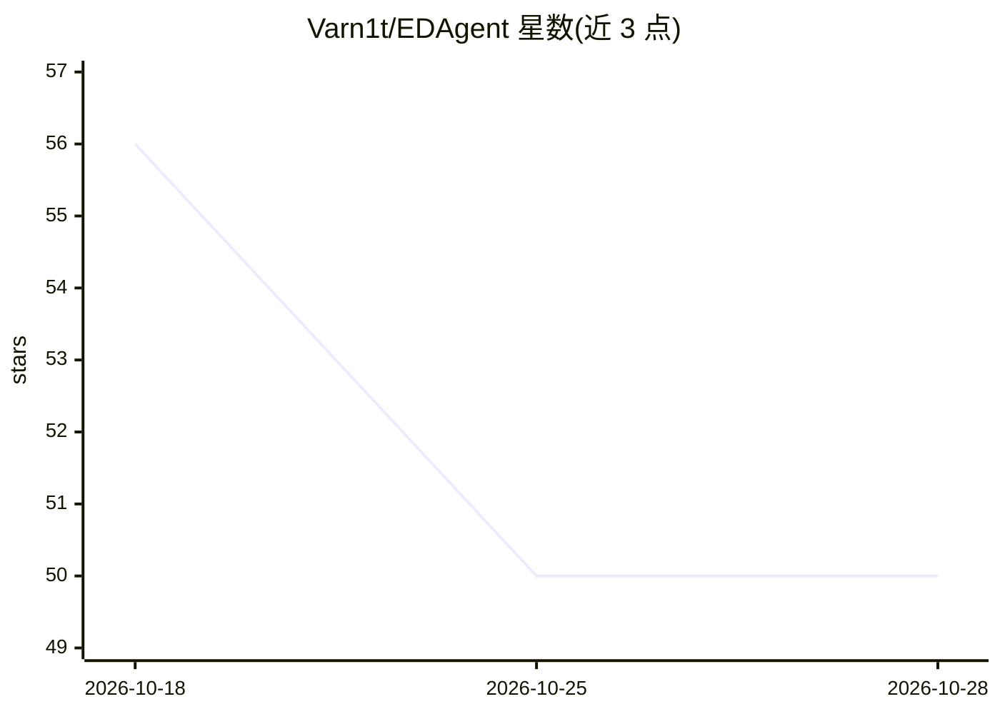

# Varn1t/EDAgent

⭐ 50 · Python · 推送 2026-06-19 · [GitHub](https://github.com/Varn1t/EDAgent) · 个人维护

**本地多智能体探索性数据分析工具：CSV 进、EDA 报告出**

基于 LangGraph 与 Ollama 的探索性数据分析流水线：输入 CSV 或 Excel 数据集后，10 个专职 AI agent 依次执行 schema 检查、质量评估、统计、离群检测、清洗、相关性、特征重要性、综合叙述、模型推荐与特征工程，产出 Streamlit 交互面板、自包含 HTML 报告、相关性热力图与清洗后数据集。Python 计算在全量数据上运行，传给 LLM 的数据有截断上限以控制上下文。全程本地推理，需预装 Ollama 并拉取模型（默认 llama3.2）。

## 筛选速览

| 维度 | 判定 | 备注 |
|---|---|---|
| AI 角色 | `ai-native` | 本体是模型或模型工具 |
| 许可风险 | `none` | — |
| 部署形态 | `library` | 以包/库形式分发 |
| 模型依赖 | local-ok | 支持本地模型 |
| 硬件要求 | — | 无带数字的原话,不猜 |
| 安装摩擦 | `low` | 无编译、无系统依赖或容器化 |
| 成熟度 | — | 结构信号不足 |

## 能力要点

- 10 阶段 LangGraph 流水线，每节点先跑 Python 工具再由 LLM 总结
- 数据清洗采用确定性预清洗 + LLM 二次处理的双通道策略
- 输出 Streamlit 仪表盘、HTML 报告、热力图与清洗后数据集
- 100% 本地运行，无 API key，可换任意 Ollama 兼容模型

## 适用场景

- 我不会写 EDA 代码，丢个 CSV 想直接得到完整分析报告
- 数据有脏值，希望自动清洗并对比清洗前后差异
- 想选模型和特征工程方向，需要 AI 给出建议

## 场景标签

`多智能体` `数据分析` · 领域:Agent 开发

## 证据(README 行号)

> L9: An agentic, LLM-powered Exploratory Data Analysis pipeline built with LangGraph and Ollama.
> L32: schema → quality → stats → outliers → cleaning → correlation → importance → synthesis → model_rec → feature_eng
> L35: Each node runs a Python analysis tool first, then passes the raw result to the LLM to reason over and summarize in 

## 星数曲线

2026-10-18 56 → 2026-10-28 50（-6）

---
*卡片 v1 · prompt 1.4 · 生成 2026-10-24 · 置信度 mid · 依据 README sha `644858a90f95` · [字段定义](../../DATASET.md)*
