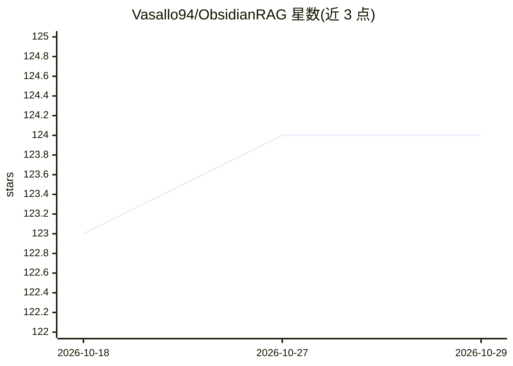

# Vasallo94/ObsidianRAG

⭐ 124 · Python · MIT · 推送 2026-09-18 · [GitHub](https://github.com/Vasallo94/ObsidianRAG) · [官网](https://pypi.org/project/obsidianrag/) · 个人维护

**用本地 AI 对 Obsidian 笔记做问答的隐私优先 RAG 插件**

由 Obsidian 插件与 Python 后端组成的本地 RAG 问答系统：后端以 SQLite FTS5 与内嵌 LanceDB 作为唯一检索引擎，做词法+向量混合检索并增量构建索引（写时复制修订、读者租约保护）；生成侧支持 Ollama、LM Studio 及任意 OpenAI 兼容服务器，回答带数字来源引用。面向希望在本地笔记库上问答且不依赖云端服务的 Obsidian 用户。后端经 PyPI/uv 安装，插件资源来自 GitHub release，另有 CLI 与 FastAPI（API 4）。限制：不自动启动索引，API 3 与 4.0.1 不兼容。

## 筛选速览

| 维度 | 判定 | 备注 |
|---|---|---|
| AI 角色 | `ai-native` | 本体是模型或模型工具 |
| 许可风险 | `permissive` | MIT |
| 部署形态 | `desktop` | 安装包/桌面程序 |
| 模型依赖 | local-ok | 支持本地模型 |
| 硬件要求 | — | 无带数字的原话,不猜 |
| 安装摩擦 | `low` | 无编译、无系统依赖或容器化 |
| 成熟度 | — | 结构信号不足 |

## 能力要点

- SQLite FTS5 + 内嵌 LanceDB 的混合词法/向量检索
- 增量写时复制索引修订与读者租约保护
- 生成支持 Ollama / LM Studio / OpenAI 兼容服务器
- 带数字来源引用的回答与 SSE 流式接口

## 适用场景

- 在自己的 Obsidian 笔记库上做本地隐私问答
- 离线环境下用 Ollama 或 LM Studio 回答笔记问题
- 需要带来源引用、可核验的笔记问答

## 场景标签

`RAG` `文档问答` · 领域:知识与检索

## 证据(README 行号)

> L3: **Ask questions about your Obsidian notes with a local-first hybrid RAG index.**
> L9: ObsidianRAG 4 uses SQLite FTS5 and embedded LanceDB as its only retrieval engine. The Obsidian plugin manages the ba

## 星数曲线

2026-10-18 123 → 2026-10-29 124（+1）

---
*卡片 v1 · prompt 1.4 · 生成 2026-10-23 · 置信度 high · 依据 README sha `9c65c02cb156` · [字段定义](../../DATASET.md)*
