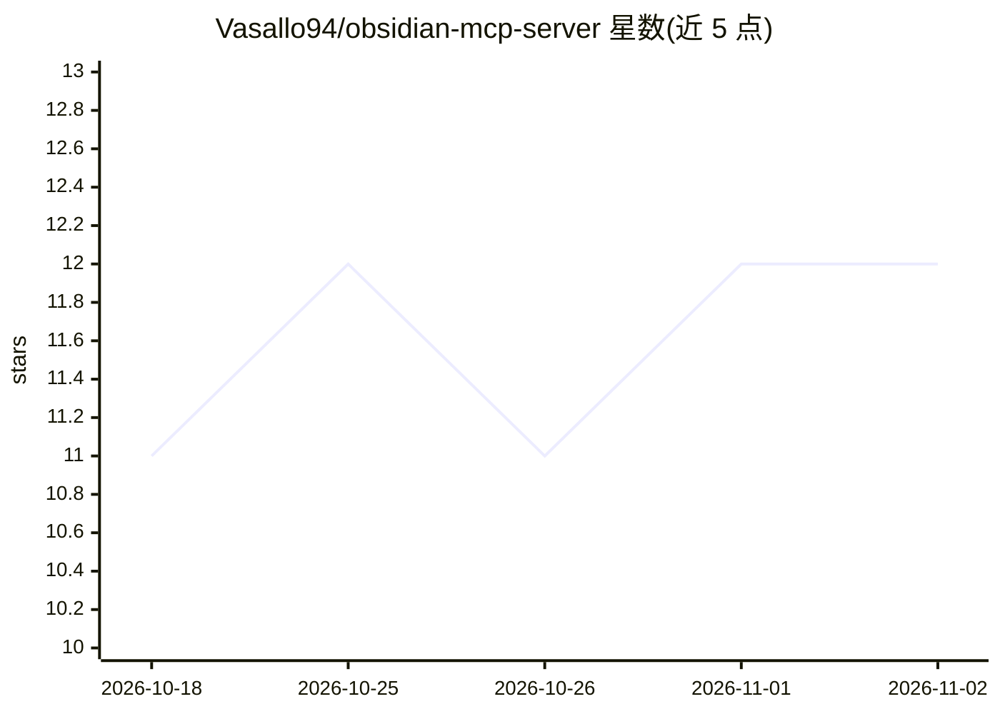

# Vasallo94/obsidian-mcp-server

⭐ 12 · Python · MIT · 推送 2026-10-31 · [GitHub](https://github.com/Vasallo94/obsidian-mcp-server) · 个人维护

**让 AI agent 读写管理 Obsidian 笔记库的 MCP 服务器**

基于 Python 与 FastMCP 的 Model Context Protocol 服务器，使 Codex、Claude Code、Hermes、Claude Desktop 等 MCP 客户端在 Obsidian vault 内读取笔记、搜索上下文、检查链接与元数据。核心工具集保持 vault 无关，可选工具集（notes_write 写入、vault_analysis 图谱分析、obsidianrag 语义搜索、youtube 转录等）需在 vault 配置或环境变量中显式开启；语义搜索委托外部 ObsidianRAG 服务而非内置 RAG。写入工具为 opt-in，受保护路径被阻止，大读取有上限。包尚未发布 PyPI，需通过 uvx 从 Git 安装。

## 筛选速览

| 维度 | 判定 | 备注 |
|---|---|---|
| AI 角色 | `ai-ecosystem` | LLM/agent 周边工具 |
| 许可风险 | `permissive` | MIT |
| 部署形态 | `library` | 以包/库形式分发 |
| 模型依赖 | — | README 未给出锁定关系 |
| 硬件要求 | — | 无带数字的原话,不猜 |
| 安装摩擦 | `medium` | 含编译或系统依赖之一 |
| 成熟度 | — | 结构信号不足 |

## 能力要点

- 公共核心工具集：笔记读取、列表、搜索、元数据与链接检查
- 可选工具集按 vault 配置/环境变量显式开启（写入、图谱分析、语义搜索等）
- 写入类工具 opt-in、受保护路径阻止、大读取封顶的安全默认
- 语义搜索通过集成外部 ObsidianRAG 服务实现

## 适用场景

- 让 Claude Code/Codex 等 agent 在我的 Obsidian 库中检索资料
- 授权 agent 按我的 vault 规则创建和修改笔记
- 通过图谱与反向链接工具分析笔记库结构

## 场景标签

`知识库管理` `Agent 记忆` · 领域:Agent 开发

## 证据(README 行号)

> L12: An **MCP (Model Context Protocol)** server that lets AI agents work inside an Obsidian vault: read notes, search co
> L14: It is designed for clients and harnesses such as **Codex**, **Claude Code**, **Hermes**, and **Claude Desktop**. Th

## 星数曲线

2026-10-18 11 → 2026-11-02 12（+1）

---
*卡片 v1 · prompt 1.4 · 生成 2026-11-01 · 置信度 mid · 依据 README sha `963bfd785571` · [字段定义](../../DATASET.md)*
