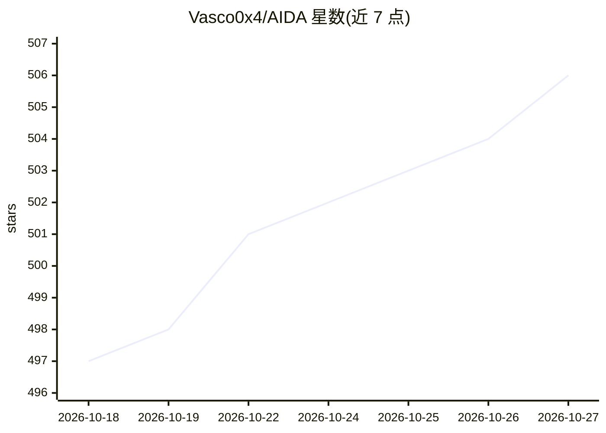

# Vasco0x4/AIDA

⭐ 506 · JavaScript · AGPL-3.0 · 推送 2026-10-21 · [GitHub](https://github.com/Vasco0x4/AIDA) · 个人维护

**把任意 LLM 变成自主渗透测试 agent 的安全评估平台**

面向安全从业者的自动化渗透测试 agent 框架：用户定义测试范围，由外部 LLM（Claude Code、Codex CLI、Kimi 等，模型无关，支持任意工具调用型 LLM 与 OpenAI 兼容 API）驱动，在隔离的 Docker 容器（内置 aida-pentest 或 Exegol，含 nmap/sqlmap/ffuf 等工具）中执行扫描、Python 脚本生成执行、HTTP 请求操控与凭据注入，并以持久化笔记记录攻击路径与发现（CVSS 4.0 自动评分），支持暂停/恢复、PDF 报告导出与多渠道通知。通过 start.sh 部署，提供 localhost:31337 的 Dashboard。

## 筛选速览

| 维度 | 判定 | 备注 |
|---|---|---|
| AI 角色 | `ai-ecosystem` | LLM/agent 周边工具 |
| 许可风险 | `viral` | AGPL-3.0 |
| 部署形态 | `None` |  |
| 模型依赖 | locked-api |  |
| 硬件要求 | — | 无带数字的原话,不猜 |
| 安装摩擦 | `low` | 无编译、无系统依赖或容器化 |
| 成熟度 | — | 结构信号不足 |

## 能力要点

- 模型无关：支持 Claude Code、Codex CLI、Kimi CLI、OpenAI 兼容 API 与 MCP 桌面客户端
- 隔离容器内执行命令，内置工具缺失时 agent 可自行安装，支持切换 Exegol（400+ 工具）
- 持久化笔记记录攻击路径与发现，CVSS 4.0 自动评分，可暂停后数日恢复重测
- 凭据占位符 {{PLACEHOLDER}} 自动注入 HTTP 请求

## 适用场景

- 在授权范围内对 Web 应用、API 与基础设施做端到端安全评估
- 让 LLM agent 自动执行侦察、扫描与自定义漏洞利用，人工仅负责复核发现
- 跨多次评估聚合查看与过滤漏洞发现并导出 PDF 报告

## 场景标签

`Agent 框架` `网络安全` · 领域:Agent 开发

## 证据(README 行号)

> L23: AIDA turns any LLM into an autonomous pentester capable of assessing web
> L112: AIDA is model-agnostic. Any LLM with tool-calling support works.
> L174: - Anthropic MCP — the tool-calling protocol powering agent actions

## 星数曲线

2026-10-18 497 → 2026-10-27 506（+9）

---
*卡片 v1 · prompt 1.4 · 生成 2026-10-21 · 置信度 high · 依据 README sha `3f23dbde36a0` · [字段定义](../../DATASET.md)*
