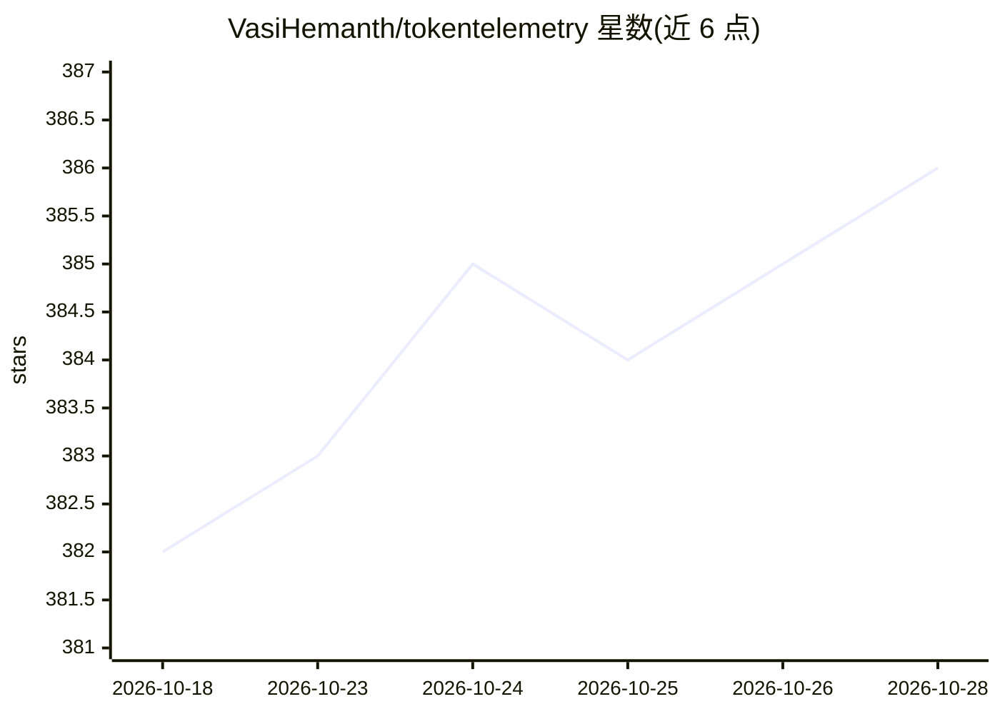

# VasiHemanth/tokentelemetry

⭐ 386 · Python · MIT · 推送 2026-10-27 · [GitHub](https://github.com/VasiHemanth/tokentelemetry) · [官网](https://tokentelemetry.com/docs/) · 个人维护

**本地观测面板：追踪 AI 编程/自主 agent 的 token、成本与会话**

面向同时使用多个 AI coding agent（Claude Code、Codex、Gemini CLI、Cursor、Copilot 等 20+ 种）及 Hermes 自主 agent 的开发者，提供 100% 本地运行的遥测面板：自动从各 agent 默认日志目录读取会话数据，展示 token 用量、LLM 成本、工具调用瀑布追踪、推理链与 plan 输出；支持按项目设预算告警（仅观测不阻断），并读取各 coding agent 的套餐配额窗口。限制：仅本地读取日志，无远程数据库模式；默认开启可选匿名遥测（可一键关闭）。

## 筛选速览

| 维度 | 判定 | 备注 |
|---|---|---|
| AI 角色 | `ai-ecosystem` | LLM/agent 周边工具 |
| 许可风险 | `permissive` | MIT |
| 部署形态 | `desktop` | 安装包/桌面程序 |
| 模型依赖 | — | README 未给出锁定关系 |
| 硬件要求 | — | 无带数字的原话,不猜 |
| 安装摩擦 | `low` | 无编译、无系统依赖或容器化 |
| 成熟度 | — | 结构信号不足 |

## 能力要点

- 自动检测并读取 20+ 种 AI coding agent 的本地会话日志
- token/成本/工具调用/推理链的会话瀑布追踪
- 按项目与 agent 设预算告警（80%/100% 阈值，观测性质）
- Hermes Agent 专属面板：38 个来源平台、网关健康、cron、子 agent 卡片

## 适用场景

- 我在用多个 AI 编程工具，想在一个地方看 token 花费和对比效率
- 想知道某次重构会话实际花了多少钱、调用了哪些工具
- 为每个项目设月度/滚动预算上限并接收告警
- 观测 Hermes 自主 agent 在各消息平台的运行与成本

## 场景标签

`LLM 可观测性` · 领域:评测与运维

## 证据(README 行号)

> L15: **TokenTelemetry** is a free, open-source, 100% local observability dashboard that tracks **token usage**, **LLM co
> L38: TokenTelemetry reads session logs from these agents automatically.

## 星数曲线

2026-10-18 382 → 2026-10-28 386（+4）

---
*卡片 v1 · prompt 1.4 · 生成 2026-10-22 · 置信度 high · 依据 README sha `547adcdb6d58` · [字段定义](../../DATASET.md)*
