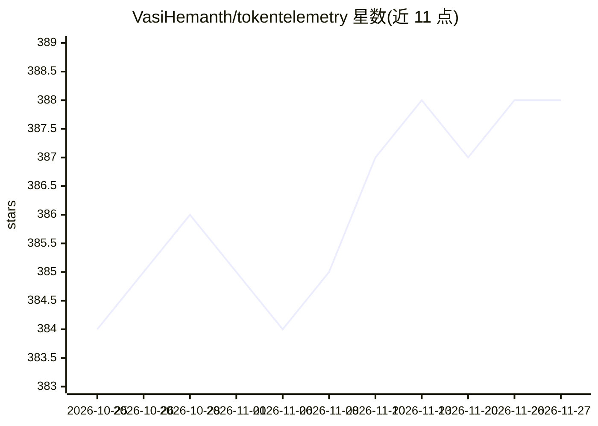

# VasiHemanth/tokentelemetry

⭐ 388 · Python · MIT · 推送 2026-11-24 · [GitHub](https://github.com/VasiHemanth/tokentelemetry) · [官网](https://tokentelemetry.com/docs/) · 个人维护

**本地 token 遥测面板：追踪多个 AI agent 的用量与成本**

以本地仪表盘形式读取已安装 AI coding/autonomous agent 的会话日志，自动检测各 agent 默认日志位置，汇总 token 用量、成本、工具调用、会话轨迹与推理步骤，覆盖 18 个 coding agent 与 Hermes Agent（后者有独立 /hermes 视图）。提供预算告警（仅观察不阻断）、订阅计划额度读取、模型效率对比与项目级洞察。数据全部留在本机，无注册无云服务，仅两项可选外呼（更新检查与匿名使用统计）。需 Node.js 20.9+、Python 3.9+ 与 git。

## 筛选速览

| 维度 | 判定 | 备注 |
|---|---|---|
| AI 角色 | `ai-ecosystem` | LLM/agent 周边工具 |
| 许可风险 | `permissive` | MIT |
| 部署形态 | `desktop` | 安装包/桌面程序 |
| 模型依赖 | — | README 未给出锁定关系 |
| 硬件要求 | — | 无带数字的原话,不猜 |
| 安装摩擦 | `low` | 无编译、无系统依赖或容器化 |
| 成熟度 | — | 结构信号不足 |

## 能力要点

- 自动检测并读取 18+ 个 coding agent 的本地会话日志
- Hermes Agent 专属面板：38 个来源平台、cron/gateway 健康、子代理卡片
- 预算与告警为观察模式，永不阻断 agent 运行
- 100% 本地：日志不离开本机，无数据库、纯 JSON 配置

## 适用场景

- 统计各 AI coding agent 会话的 token 消耗与 API 成本
- 在一个面板里统一查看多个 agent 的会话轨迹与工具调用
- 监控 Hermes Agent 在多平台上的运行状态与成本异常

## 场景标签

`LLM 可观测性` · 领域:评测与运维

## 证据(README 行号)

> L15: **TokenTelemetry** is a free, open-source, 100% local observability dashboard that tracks **token usage**, **LLM co
> L38: TokenTelemetry reads session logs from these agents automatically.

## 星数曲线

2026-10-25 384 → 2026-11-27 388（+4）

---
*卡片 v1 · prompt 1.4 · 生成 2026-11-25 · 置信度 high · 依据 README sha `3b21c1115dba` · [字段定义](../../DATASET.md)*
