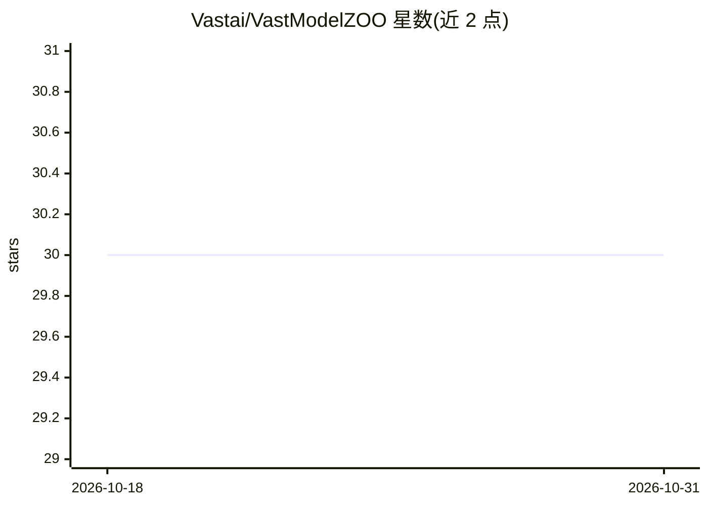

# Vastai/VastModelZOO

⭐ 30 · Python · Apache-2.0 · 推送 2026-10-29 · [GitHub](https://github.com/Vastai/VastModelZOO) · [官网](https://vastai.github.io/VastModelZOO/) · 组织维护 · 中文 README

**瀚博训推芯片上的开源模型部署与训练示例库**

由瀚博半导体 VastAI-AIS 团队维护的 AI 模型平台，收录 CV、AUDIO、NLP、LLM、MLLM 等领域的开源模型在瀚博 GPU 芯片上的部署与训练示例，展示基于瀚博硬件和软件 SDK 的编程实践以实现模型快速移植。使用前需联系销售获取瀚博开发者中心权限并安装 VVI 部署软件包，安装流程包括驱动安装、加速卡参数设置、Build_In 或 vLLM 后端运行环境部署。模型仅供非商业目的使用，仓库遵循 Apache 2.0。

## 筛选速览

| 维度 | 判定 | 备注 |
|---|---|---|
| AI 角色 | `ai-ecosystem` | LLM/agent 周边工具 |
| 许可风险 | `permissive` | Apache-2.0 |
| 部署形态 | `library` | 以包/库形式分发 |
| 模型依赖 | local-ok | 支持本地模型 |
| 硬件要求 | — | 无带数字的原话,不猜 |
| 安装摩擦 | `low` | 无编译、无系统依赖或容器化 |
| 成熟度 | — | 结构信号不足 |

## 能力要点

- 覆盖 CV/AUDIO/NLP/LLM/MLLM 多领域的模型部署与训练示例
- 支持 Build_In 与 vLLM 两种后端运行环境
- 提供驱动安装、加速卡参数设置到运行环境部署的完整流程
- 提供混合部署方案（vLLM+Build_In）说明

## 适用场景

- 在瀚博训推芯片上部署或训练开源模型
- 参考瀚博 SDK 的模型移植编程实践
- 查找已适配瀚博硬件的模型清单

## 场景标签

`推理引擎` `模型训练` · 领域:训练与推理

## 证据(README 行号)

> L8: `VastModelZOO`是`瀚博半导体VastAI-AIS团队`维护的AI模型平台，提供了人工智能多个领域（CV、AUDIO、NLP、LLM、MLLM等）的开源模型在瀚博GPU芯片上的部署、训练示例。
> L10: `VastModelZOO`旨在基于`瀚博半导体VastAI`的硬件产品和软件SDK，展示最佳的编程实践，以达成模型的快速移植和最优性能。

## 星数曲线

2026-10-18 30 → 2026-10-31 30（+0）

---
*卡片 v1 · prompt 1.4 · 生成 2026-10-26 · 置信度 high · 依据 README sha `558c488952d9` · [字段定义](../../DATASET.md)*
