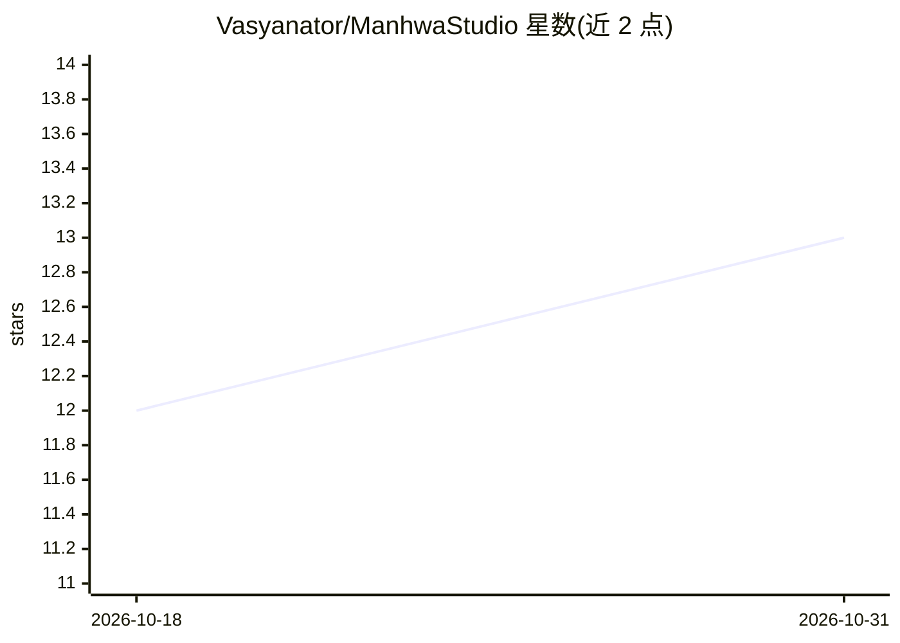

# Vasyanator/ManhwaStudio

⭐ 13 · Rust · GPL-3.0 · 推送 2026-10-28 · [GitHub](https://github.com/Vasyanator/ManhwaStudio) · 个人维护 · 中文 README

**面向人工翻译流程的漫画/webtoon 一体化翻译排版桌面程序**

覆盖漫画翻译全流程的桌面工具：从站点下载章节、PSD/PSB 导入、切条拼接、放大去噪，到 OCR 识别（EasyOCR/MangaOCR/PaddleOCR/SuryaOCR/AI API）、调用 AI 服务接口翻译、AI 消字（Lama 到 Flux 等模型）、以及带描边/发光/渐变等效果的排版系统。支持角色表、术语表与翻译注记注入 AI 翻译指令以保持译名一致。定位为以人工操作为主而非全自动，通过 Releases 安装包分发，Windows/Linux/macOS 均支持，也可用脚本从源码构建（首次构建会安装 Rust 并编译）。

## 筛选速览

| 维度 | 判定 | 备注 |
|---|---|---|
| AI 角色 | `ai-native` | 本体是模型或模型工具 |
| 许可风险 | `viral` | GPL-3.0 |
| 部署形态 | `desktop` | 安装包/桌面程序 |
| 模型依赖 | — | README 未给出锁定关系 |
| 硬件要求 | — | 无带数字的原话,不猜 |
| 安装摩擦 | `low` | 无编译、无系统依赖或容器化 |
| 成熟度 | `idea` | |

## 能力要点

- 多引擎 OCR：EasyOCR、MangaOCR、PaddleOCR、PaddleOCR-VL、SuryaOCR、AI API
- AI 消字支持从 Lama 到 Flux 的多种模型
- 角色/术语表自动注入 AI 翻译指令，保持译名一致
- webtoon 智能切条拼接与 Reline/Waifu2x 放大去噪

## 适用场景

- 个人汉化/翻译漫画与 webtoon 章节
- 从站点下载章节并做嵌字排版
- 用 AI 快速识别与机翻原文做粗读
- 维护角色名与术语表以保证系列翻译一致性

## 场景标签

`OCR` `图像视频处理` · 领域:感知与多模态

## 证据(README 行号)

> L58: - Text recognition via EasyOCR, MangaOCR, PaddleOCR, PaddleOCR-VL, SuryaOCR, AI API
> L62: - Translation through the APIs of various AI services
> L70: - AI removal for text on complex backgrounds using various AI models, from Lama to Flux

## 星数曲线

2026-10-18 12 → 2026-10-31 13（+1）

---
*卡片 v1 · prompt 1.4 · 生成 2026-10-31 · 置信度 high · 依据 README sha `1687a301acad` · [字段定义](../../DATASET.md)*
