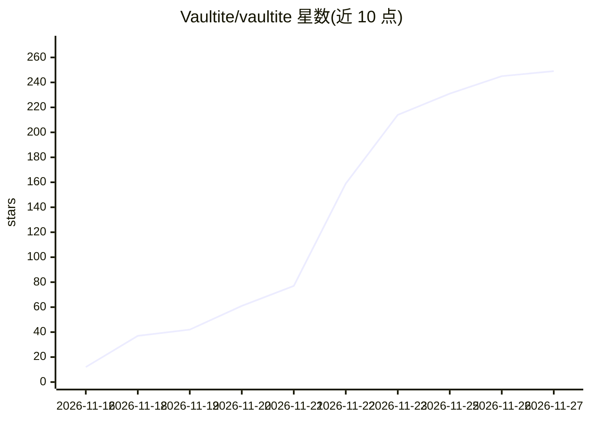

# Vaultite/vaultite

⭐ 249 · TypeScript · Apache-2.0 · 推送 2026-11-26 · [GitHub](https://github.com/Vaultite/vaultite) · [官网](https://vaultite.com) · 个人维护

**本地优先的 Markdown 个人知识库，可与 AI 共同读写**

Vaultite 是一个本地运行的第二大脑知识库：以纯 Markdown 文件夹为存储（无数据库），提供编辑器、页面渲染与链接知识图谱。面向个人用户与其 AI 助手：通过 vau CLI、MCP 和 HTTP 提供统一操作接口，供 Claude Code、Codex 等 agent 读写同一份 vault。全插件化架构，兼容现有 Obsidian vault 及 105/126 个已测试社区插件。提供 macOS/Windows/Linux 桌面安装包、Web 版与服务器部署方式（systemd 用户单元），Apache 2.0 许可。

## 筛选速览

| 维度 | 判定 | 备注 |
|---|---|---|
| AI 角色 | `ai-enhanced` | 去掉 AI 部分产品仍成立 |
| 许可风险 | `permissive` | Apache-2.0 |
| 部署形态 | `library` | 以包/库形式分发 |
| 模型依赖 | locked-api |  |
| 硬件要求 | — | 无带数字的原话,不猜 |
| 安装摩擦 | `medium` | 含编译或系统依赖之一 |
| 成熟度 | — | 结构信号不足 |

## 能力要点

- 纯 Markdown 文件存储，无数据库，可用其他工具打开或用 git 同步
- 兼容 Obsidian vault，已测试 126 个社区插件中的 105 个可用
- 通过 vau CLI/MCP/HTTP 向 Claude Code、Codex 等 agent 开放统一操作
- 全插件化架构（文件树也是插件），支持热加载与自写插件

## 适用场景

- 把现有 Obsidian 笔记库接入 AI 助手共同维护
- 用自然语言让 agent 记录日程、人物和健康数据
- 在家用服务器或 VPS 上自托管知识库并通过内网访问

## 场景标签

`知识库管理` `知识图谱` · 领域:知识与检索

## 证据(README 行号)

> L4:  Own your memories. A local knowledge base you and your AI write together, in plain Markdown files.
> L27: - **Made for agents.** Claude Code, Codex and any MCP client share one set of operations (the `vau` CLI, MCP, HTTP)
> L30: - **A full editor and workspace**: live preview, tabs and splits, backlinks, graph and terminals for your agents, o

## 星数曲线

2026-11-16 12 → 2026-11-27 249（+237）

---
*卡片 v1 · prompt 1.4 · 生成 2026-11-27 · 置信度 mid · 依据 README sha `9c34ea277242` · [字段定义](../../DATASET.md)*
