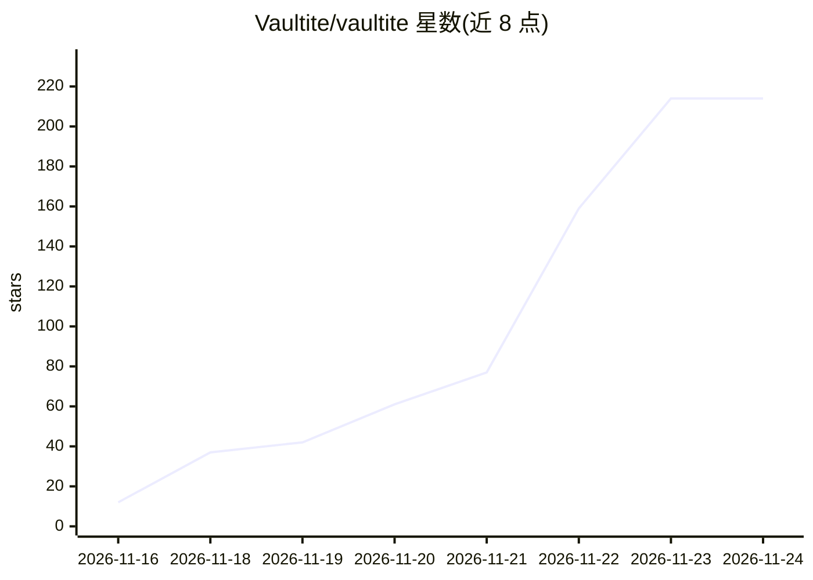

# Vaultite/vaultite

⭐ 231 · TypeScript · Apache-2.0 · 推送 2026-11-23 · [GitHub](https://github.com/Vaultite/vaultite) · [官网](https://vaultite.com) · 组织维护

**本地优先的 Markdown 知识库，人与 AI 共同读写笔记**

以纯 Markdown 文件夹为存储的个人知识库（第二大脑）：Vaultite 将 vault 渲染为页面与链接知识图谱，可直接打开现有 Obsidian vault（126 个社区插件中 105 个经适配可用）。AI 通过 Claude Code、Codex 及任意 MCP 客户端接入，共享 vau CLI/MCP/HTTP 一套操作；也可在设置中连接 Claude、ChatGPT、Muse、Grok Bot。全部功能为热重载插件，含编辑器、反向链接、图谱与终端。提供 macOS/Windows/Linux 桌面安装包，Apache 2.0。

## 筛选速览

| 维度 | 判定 | 备注 |
|---|---|---|
| AI 角色 | `ai-enhanced` | 去掉 AI 部分产品仍成立 |
| 许可风险 | `permissive` | Apache-2.0 |
| 部署形态 | `library` | 以包/库形式分发 |
| 模型依赖 | — | README 未给出锁定关系 |
| 硬件要求 | — | 无带数字的原话,不猜 |
| 安装摩擦 | `medium` | 含编译或系统依赖之一 |
| 成熟度 | — | 结构信号不足 |

## 能力要点

- 纯 Markdown 文件存储，无数据库，可 git/iCloud 同步
- 兼容 Obsidian vault（105/126 社区插件可用）
- 为 agent 设计：vau CLI、MCP、HTTP 共享操作集
- 全插件化架构，支持热重载与自写插件

## 适用场景

- 把现有 Obsidian 笔记库交给 AI 代理共同维护
- 记录日程、人物关系、健康数据的本地第二大脑
- 在自家服务器或 VPS 上自托管，供桌面与手机访问

## 场景标签

`知识库管理` · 领域:知识与检索

## 证据(README 行号)

> L20: A second brain for you and your AI: a folder of Markdown files (your vault) you both write in, which Vaultite draws
> L27: - **Made for agents.** Claude Code, Codex and any MCP client share one set of operations (the `vau` CLI, MCP, HTTP)

## 星数曲线

2026-11-16 12 → 2026-11-24 214（+202）

---
*卡片 v1 · prompt 1.4 · 生成 2026-11-18 · 置信度 low · 依据 README sha `67700d7090f3` · [字段定义](../../DATASET.md)*
