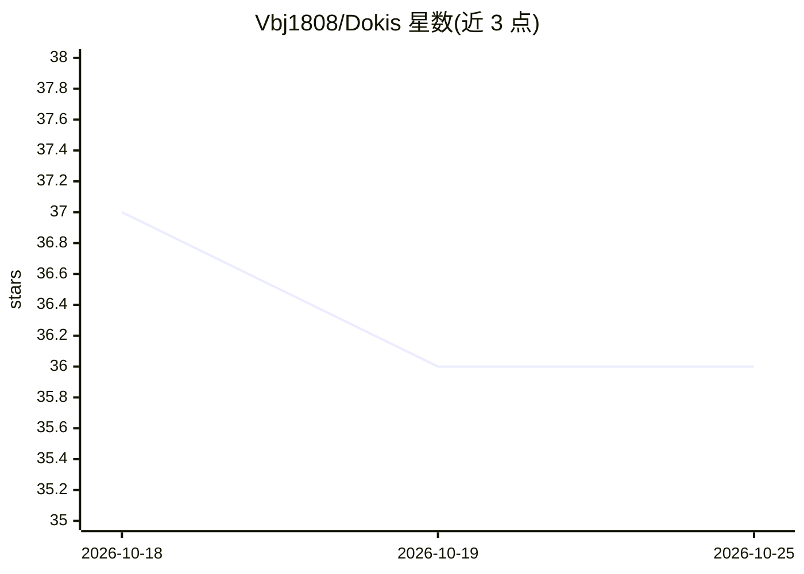

# Vbj1808/Dokis

⭐ 36 · Python · MIT · 推送 2026-04-28 · [GitHub](https://github.com/Vbj1808/Dokis) · [官网](https://pypi.org/project/dokis/) · 个人维护

**RAG 回答的运行时来源审计库：核验每条回答是否有出处**

嵌入在检索与回答交付之间的检查层：从回答中抽取事实声明，映射到检索片段与来源 URL，输出合规率、违规清单与新鲜度判定；检索前按来源白名单过滤片段。默认路径用 BM25 匹配，无需 LLM 调用与 API key，输出确定性可复现。以 Python 库形式提供，另带 CLI 与三个示例工程。

## 筛选速览

| 维度 | 判定 | 备注 |
|---|---|---|
| AI 角色 | `ai-ecosystem` | LLM/agent 周边工具 |
| 许可风险 | `permissive` | MIT |
| 部署形态 | `library` | 以包/库形式分发 |
| 模型依赖 | local-ok | 支持本地模型 |
| 硬件要求 | — | 无带数字的原话,不猜 |
| 安装摩擦 | `low` | 无编译、无系统依赖或容器化 |
| 成熟度 | — | 结构信号不足 |

## 能力要点

- claim→chunk→URL 的溯源映射与合规率计算
- 默认 BM25 路径无需 LLM 调用与 API key，输出确定性
- 来源白名单过滤与新鲜度策略（fresh/stale/unsupported 判定）
- 提供 LangChain / LlamaIndex 集成适配器

## 适用场景

- RAG 系统上线时拦截无来源或编造的回答
- 企业问答系统按来源白名单做合规审计
- 核验回答所依赖资料的时效性

## 场景标签

`RAG` `模型评测` · 领域:评测与运维

## 证据(README 行号)

> L18: Dokis sits inline between retrieval and response delivery and returns a runtime trust report for the exact answer y
> L33: **3. Temporal trust evaluation.** If freshness policy is configured, derive source age from chunk metadata and dist
> L50: result = dokis.audit(query, chunks, response)

## 星数曲线

2026-10-18 37 → 2026-10-25 36（-1）

---
*卡片 v1 · prompt 1.4 · 生成 2026-10-25 · 置信度 high · 依据 README sha `b4f6ca40fc64` · [字段定义](../../DATASET.md)*
