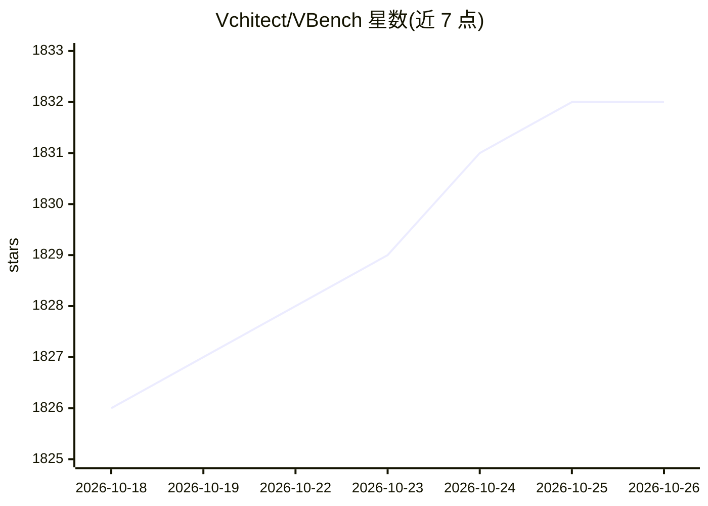

# Vchitect/VBench

⭐ 1,832 · Python · Apache-2.0 · 推送 2026-08-21 · [GitHub](https://github.com/Vchitect/VBench) · [官网](https://vchitect.github.io/VBench-project/) · 组织维护

**视频生成模型评测基准套件：多维度自动化评估 T2V/I2V 模型**

VBench 系列工作的统一实现仓库，对视频生成模型做多维度自动化评测：VBench 覆盖 16 个文本到视频评测维度（一致性、动态程度、美学质量等）；VBench++ 扩展图生视频（I2V）、长视频与可信度评测；VBench-2.0 增加 5 大类 18 个细粒度维度的内在忠实度评测（常识推理、物理真实性等）。每个维度配有 Prompt Suite 与自动评测方法，并做人类偏好标注验证对齐。面向视频生成模型的研究者与开发者，以 pip 包和源码方式提供，配套 HuggingFace 排行榜与 Arena 展示（18 万+生成视频）。评测依赖 PyTorch（CUDA），部分维度需另装 detectron2。

## 筛选速览

| 维度 | 判定 | 备注 |
|---|---|---|
| AI 角色 | `ai-ecosystem` | LLM/agent 周边工具 |
| 许可风险 | `permissive` | Apache-2.0 |
| 部署形态 | `library` | 以包/库形式分发 |
| 模型依赖 | — | README 未给出锁定关系 |
| 硬件要求 | — | 无带数字的原话,不猜 |
| 安装摩擦 | `medium` | 含编译或系统依赖之一 |
| 成熟度 | — | 结构信号不足 |

## 能力要点

- 16 个 T2V 评测维度，配套 Prompt Suite 与自动评测方法
- VBench++ 支持 I2V、长视频与可信度（公平性/偏见/安全）评测
- VBench-2.0 评测内在忠实度：常识推理、物理真实性等 5 大类 18 维度
- 支持评测用户自定义视频，配套 HuggingFace 排行榜与 Arena

## 适用场景

- 评测自己训练的视频生成模型在多维度上的表现
- 对比开源与闭源视频生成模型的量化排名
- 为论文或选型提供可复现的视频生成评测结果

## 场景标签

`模型评测` · 领域:评测与运维

## 证据(README 行号)

> L14: This repository provides unified implementations for the **VBench series** of works, supporting comprehensive evalu
> L34: We propose **VBench**, a comprehensive benchmark suite for video generative models. We design a comprehensive and h
> L82: Overview of VBench-2.0. (a) Scope of VBench-2.0. Video generative models have progressed from achieving superficial

## 星数曲线

2026-10-18 1,826 → 2026-10-26 1,832（+6）

---
*卡片 v1 · prompt 1.4 · 生成 2026-10-21 · 置信度 high · 依据 README sha `05b2b6c662cf` · [字段定义](../../DATASET.md)*
